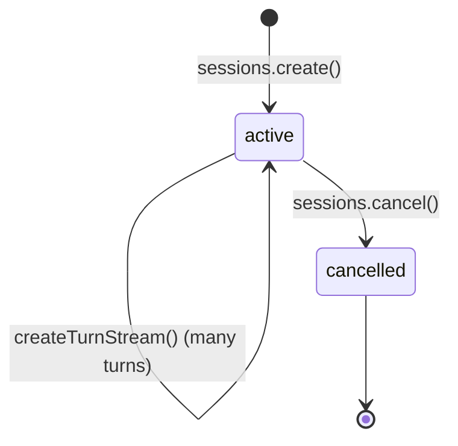
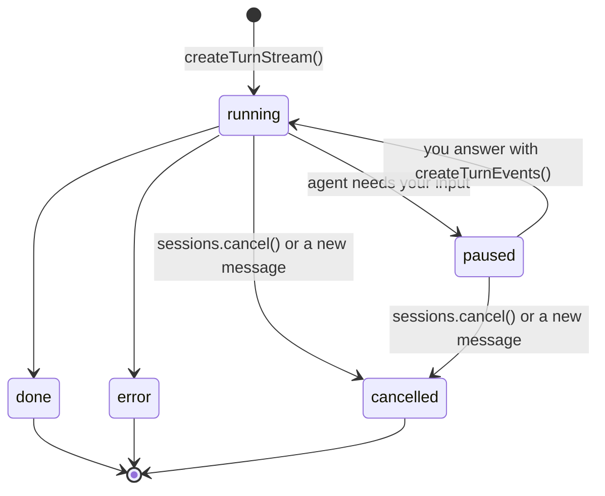
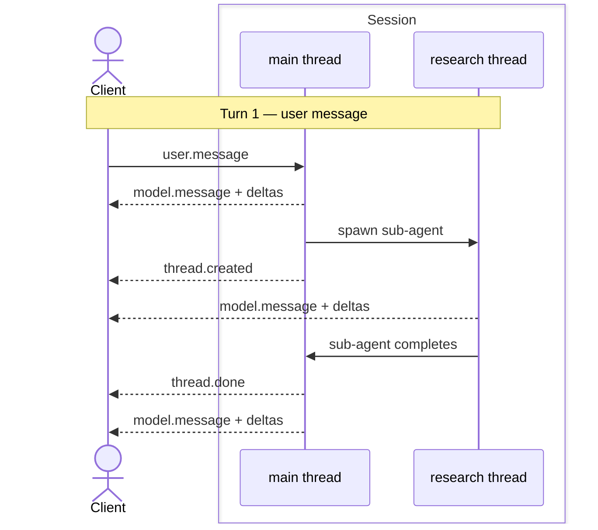

The recipe book for running an agent with [`@truefoundry/trueforge-sdk`](https://www.npmjs.com/package/@truefoundry/trueforge-sdk) or [`trueforge-sdk`](https://pypi.org/project/trueforge-sdk/). New here? Install and stream your first turn in the [SDK Quickstart](/api/quickstart) first. For the mental model (Agent → Session → Turn → Event → Delta), see [Concepts](/api/overview-v2); for every event field, see the [turn events reference](#turn-events-reference) at the bottom of this page.

<Note>
Prerequisite: a named agent in the registry, or an inline [agent spec](/create-agent/overview#create-an-agent-via-the-api) you pass when creating the session. The examples below run the **`web-research-brief`** agent from the [Quickstart](/quickstart); build it there first, or swap in your own agent name / inline spec.
</Note>

Every snippet is self-contained and runnable. They all use the `client` from [Install and connect](#install-and-connect).

## Install and connect

<CodeGroup>
```bash TypeScript wrap
npm i @truefoundry/trueforge-sdk
```

```bash Python wrap
pip install trueforge-sdk
```
</CodeGroup>

<CodeGroup>
```typescript TypeScript wrap
import { TrueForge } from '@truefoundry/trueforge-sdk';

const client = new TrueForge({
  baseUrl: process.env.TRUEFORGE_BASE_URL ?? 'http://localhost:8790',
  timeoutInSeconds: 600, // raise for long-running SSE turns (default 60s)
  // token: process.env.TRUEFORGE_TOKEN, // ID token when OIDC login is enabled
});
```

```python Python wrap
import os
from trueforge_sdk import TrueForge

client = TrueForge(
    base_url=os.environ.get("TRUEFORGE_BASE_URL", "http://localhost:8790"),
    timeout=600,  # raise for long-running SSE turns (default 60s)
    # token=os.environ.get("TRUEFORGE_TOKEN"),  # ID token when OIDC login is enabled
)
```
</CodeGroup>

Point `baseUrl` / `base_url` at your running TrueForge server; `http://localhost:8790` is the Quickstart default. When [OIDC login](/authentication/overview) is enabled, pass `token` (an ID token from your IdP; see [Get a token and connect](/api/quickstart#get-a-token-and-connect)). When login is off, omit it. TypeScript fields are camelCase; Python fields match the wire format (`snake_case`).

## Quick Start

The [Concepts](/api/overview-v2) page explains the model with a conceptual `support-bot`; here is a real agent you can run. In the [Quickstart](/quickstart) you built **`web-research-brief`**, an agent with Exa web search and the web-artifacts-builder skill. Here it is from the SDK: open a session on that agent, stream one research turn, and print the brief as it arrives. It fans out to [subagents](/key-features/subagents), so you'll see their threads in the same stream. It has no approval gate, so it runs end to end without waiting on you; for approvals and questions, see [Handle pauses](#handle-pauses).

<CodeGroup>
```typescript TypeScript wrap
import { TrueForge } from '@truefoundry/trueforge-sdk';

const client = new TrueForge({
  baseUrl: process.env.TRUEFORGE_BASE_URL ?? 'http://localhost:8790',
  timeoutInSeconds: 600,
});

// The agent you saved in the Quickstart.
const { data: session } = await client.sessions.create({ agent: { name: 'web-research-brief' } });

const stream = await client.sessions.createTurnStream(session.id, {
  input: [
    {
      type: 'user.message',
      content:
        'Compare Qdrant, Weaviate, and Milvus on performance, features, and licensing, then write a one-page brief with sources.',
    },
  ],
});

for await (const { data: event } of stream.withMetadata()) {
  if (event.type === 'thread.created') console.log(`\n↳ subagent: ${event.title}`);
  if (event.type === 'model.message.delta' && event.threadId === 'main') {
    process.stdout.write(event.content ?? ''); // the root agent's reply, streaming in
  }
  if (event.type === 'turn.done' && event.state.status === 'done') {
    console.log('\n\n--- brief ---\n', event.state.output?.content ?? '');
  }
}
```

```python Python wrap
import os
from trueforge_sdk import TrueForge

client = TrueForge(
    base_url=os.environ.get("TRUEFORGE_BASE_URL", "http://localhost:8790"),
    timeout=600,
)

# The agent you saved in the Quickstart.
session = client.sessions.create(agent={"name": "web-research-brief"})

stream = client.sessions.create_turn_stream(
    session_id=session.data.id,
    input=[
        {
            "type": "user.message",
            "content": "Compare Qdrant, Weaviate, and Milvus on performance, features, and licensing, then write a one-page brief with sources.",
        },
    ],
)

for event in stream:
    if event.type == "thread.created":
        print(f"\n↳ subagent: {event.title}")
    if event.type == "model.message.delta" and event.thread_id == "main":
        print(event.content or "", end="", flush=True)
    if event.type == "turn.done" and event.state.status == "done":
        output = event.state.output
        print("\n\n--- brief ---\n", None if output is None else output.content)
```
</CodeGroup>

That's the core loop: open a session, stream a turn, print the reply as it arrives, and read the final `turn.done`. This version writes each delta straight to stdout. The [next section](#create-and-stream-a-turn) keeps an id-keyed event index, the pattern the pause recipes build on. The rest of the page is a reference for each piece, plus the pauses (approvals, questions, MCP auth) a real agent runs into.

## Sessions

A **session** is the conversation context for one issue; it persists across turns. Persist `session.id` to resume later.



### Open a session

<CodeGroup>
```typescript TypeScript wrap
import { TrueForge } from '@truefoundry/trueforge-sdk';

const client = new TrueForge({ baseUrl: process.env.TRUEFORGE_BASE_URL ?? 'http://localhost:8790' });

// By saved agent name:
const { data: session } = await client.sessions.create({ agent: { name: 'web-research-brief' } });

// …or with an inline spec (no saved agent needed):
const { data: inlineSession } = await client.sessions.create({
  agent: {
    spec: {
      model: { name: 'anthropic/claude-sonnet-4-6' },
      instructions: 'You are a concise research assistant.',
    },
  },
});
```

```python Python wrap
import os
from trueforge_sdk import TrueForge

client = TrueForge(base_url=os.environ.get("TRUEFORGE_BASE_URL", "http://localhost:8790"))

# By saved agent name:
session = client.sessions.create(agent={"name": "web-research-brief"})

# …or with an inline spec (no saved agent needed):
inline_session = client.sessions.create(
    agent={
        "spec": {
            "model": {"name": "anthropic/claude-sonnet-4-6"},
            "instructions": "You are a concise research assistant.",
        },
    },
)
```
</CodeGroup>

### List sessions

Newest-first; filter with `agentId` / `agent_id`. TypeScript returns a `Page` async iterable; Python returns a `SyncPager`. Both auto-paginate.

<CodeGroup>
```typescript TypeScript wrap
import { TrueForge } from '@truefoundry/trueforge-sdk';

const client = new TrueForge({ baseUrl: process.env.TRUEFORGE_BASE_URL ?? 'http://localhost:8790' });

for await (const session of await client.sessions.list()) {
  console.log(session.id, session.createdAt);
}
```

```python Python wrap
import os
from trueforge_sdk import TrueForge

client = TrueForge(base_url=os.environ.get("TRUEFORGE_BASE_URL", "http://localhost:8790"))

for session in client.sessions.list():
    print(session.id, session.created_at)
```
</CodeGroup>

## Turns

A **turn** is one request/response cycle: you send a message, and the agent works until it has an answer. If it needs something from you along the way (an approval, an answer, or an MCP sign-in), the turn **pauses** and waits. You answer on the same turn and it carries on. Turns chain automatically (`previousTurnId` defaults to `"auto"`), so you never resend history.



<Note>
Only one turn is active in a session at a time. Sending a new message cancels a turn that is still running or waiting for an answer, and the new turn picks up from there.
</Note>

### Create and stream a turn

`createTurnStream` / `create_turn_stream` returns a stream of [turn events](#turn-events-reference). The stream opens with `turn.created` and closes with `turn.done`; read the final result from `turn.done.state`. If the turn pauses, the stream stays open and continues once you answer.

Keep an **`id`-keyed event index**. Model output streams as an empty `model.message` base followed by `model.message.delta` fragments that share the base's `id`. Store each non-delta event under its `id` and merge each delta into the base with TypeScript `isEventDelta` / `mergeEventDelta` or Python `is_event_delta` / `merge_event_delta` (`from trueforge_sdk.events import …`). (Deltas appear only while streaming; [`listTurnEvents`](#replay-a-turn) / `list_turn_events` returns them already merged.) Pause handlers and the per-thread index below reuse this pattern.

Also keep the turn id (from `turn.created`) and the `id` of the last event you received. You need the turn id to answer a paused turn, and the last event id to [resume the stream](#resume-a-stream) if the connection drops.

<CodeGroup>
```typescript TypeScript wrap
import { TrueForge, TrueForgeApi, isEventDelta, mergeEventDelta } from '@truefoundry/trueforge-sdk';

const client = new TrueForge({
  baseUrl: process.env.TRUEFORGE_BASE_URL ?? 'http://localhost:8790',
  timeoutInSeconds: 600,
});
const { data: session } = await client.sessions.create({ agent: { name: 'web-research-brief' } });

const events = new Map<string, TrueForgeApi.TurnStreamingEvent>();
let turnId: string | undefined;
let lastEventId: string | undefined;

const stream = await client.sessions.createTurnStream(session.id, {
  input: [{ type: 'user.message', content: 'Summarize the current state of open-source vector databases.' }],
});
for await (const { data: event } of stream.withMetadata()) {
  lastEventId = event.id;
  if (event.type === 'turn.created') turnId = event.turnId;
  if (isEventDelta(event)) {
    const base = events.get(event.id);
    if (base) mergeEventDelta(base, event);
  } else {
    events.set(event.id, event);
  }
  if (event.type === 'turn.done') console.log('status:', event.state.status);
}
```

```python Python wrap
import os
from trueforge_sdk import TrueForge
from trueforge_sdk.events import is_event_delta, merge_event_delta

client = TrueForge(
    base_url=os.environ.get("TRUEFORGE_BASE_URL", "http://localhost:8790"),
    timeout=600,
)
session = client.sessions.create(agent={"name": "web-research-brief"})

events = {}
turn_id = None
last_event_id = None

stream = client.sessions.create_turn_stream(
    session_id=session.data.id,
    input=[{"type": "user.message", "content": "Summarize the current state of open-source vector databases."}],
)
for event in stream:
    last_event_id = event.id
    if event.type == "turn.created":
        turn_id = event.turn_id
    if is_event_delta(event):
        base = events.get(event.id)
        if base is not None:
            merge_event_delta(base, event)
    else:
        events[event.id] = event
    if event.type == "turn.done":
        print("status:", event.state.status)
```
</CodeGroup>

A turn's `input` is one or more `user.message` items. `content` is a non-empty string, or an array of `text` / `file` parts (files as data URIs). Approvals, answers, and MCP sign-ins are not part of `input`; you send them to the paused turn, as shown in [Handle pauses](#handle-pauses).

### Non-streaming turn

If you don't need live events, TypeScript `sessions.createTurn` (`stream: false`) and Python `sessions.create_turn` return immediately with `state.status: "running"` and run in the background. Poll `getTurn` / `get_turn` while the status is `running`. When it stops, the turn has either finished (`done`, `cancelled`, `error`) or is `paused` and waiting for you; see [Answer later](#answer-later) for how to find out what it needs.

<CodeGroup>
```typescript TypeScript wrap
import { TrueForge } from '@truefoundry/trueforge-sdk';

const client = new TrueForge({ baseUrl: process.env.TRUEFORGE_BASE_URL ?? 'http://localhost:8790' });
const { data: session } = await client.sessions.create({ agent: { name: 'web-research-brief' } });

const { data: created } = await client.sessions.createTurn(session.id, {
  input: [{ type: 'user.message', content: 'Give me a one-paragraph summary of the Qdrant licensing model.' }],
});

let turn = created;
while (turn.state.status === 'running') {
  await new Promise((resolve) => setTimeout(resolve, 500));
  ({ data: turn } = await client.sessions.getTurn(session.id, created.id));
}
console.log(turn.state); // done → output; paused → waiting for you; else reason / message
```

```python Python wrap
import os
import time
from trueforge_sdk import TrueForge

client = TrueForge(base_url=os.environ.get("TRUEFORGE_BASE_URL", "http://localhost:8790"))
session = client.sessions.create(agent={"name": "web-research-brief"})

created = client.sessions.create_turn(
    session_id=session.data.id,
    input=[{"type": "user.message", "content": "Give me a one-paragraph summary of the Qdrant licensing model."}],
)

turn = created.data
while turn.state.status == "running":
    time.sleep(0.5)
    turn = client.sessions.get_turn(session_id=session.data.id, turn_id=created.data.id).data
print(turn.state)  # done → output; paused → waiting for you; else reason / message
```
</CodeGroup>

### List turns

Oldest-first; each turn exposes its `input` and `state`.

<CodeGroup>
```typescript TypeScript wrap
import { TrueForge } from '@truefoundry/trueforge-sdk';

const client = new TrueForge({ baseUrl: process.env.TRUEFORGE_BASE_URL ?? 'http://localhost:8790' });

for await (const turn of await client.sessions.listTurns('sess-abc123')) {
  console.log(turn.id, turn.state.status);
  if (turn.state.status === 'done' && turn.state.output != null) {
    console.log(turn.state.output.content);
  }
}
```

```python Python wrap
import os
from trueforge_sdk import TrueForge

client = TrueForge(base_url=os.environ.get("TRUEFORGE_BASE_URL", "http://localhost:8790"))

for turn in client.sessions.list_turns(session_id="sess-abc123"):
    print(turn.id, turn.state.status)
    if turn.state.status == "done" and turn.state.output is not None:
        print(turn.state.output.content)
```
</CodeGroup>

### Attach images or files

A `user.message`'s `content` can be an array of parts: text plus one or more files as [data URIs](https://developer.mozilla.org/en-US/docs/Web/HTTP/Basics_of_HTTP/Data_URLs) (`data:<mime>;base64,<payload>`).

<CodeGroup>
```typescript TypeScript wrap
import { readFileSync } from 'node:fs';
import { TrueForge } from '@truefoundry/trueforge-sdk';

const client = new TrueForge({
  baseUrl: process.env.TRUEFORGE_BASE_URL ?? 'http://localhost:8790',
  timeoutInSeconds: 600,
});
const { data: session } = await client.sessions.create({ agent: { name: 'web-research-brief' } });

const toDataUri = (path: string, mime: string) => `data:${mime};base64,${readFileSync(path).toString('base64')}`;

const stream = await client.sessions.createTurnStream(session.id, {
  input: [
    {
      type: 'user.message',
      content: [
        { type: 'text', text: 'Use this chart in the brief.' },
        { type: 'file', name: 'benchmarks.png', data: toDataUri('benchmarks.png', 'image/png') },
      ],
    },
  ],
});
for await (const { data: event } of stream.withMetadata()) console.log(event.type);
```

```python Python wrap
import base64
import os
from pathlib import Path
from trueforge_sdk import TrueForge

client = TrueForge(
    base_url=os.environ.get("TRUEFORGE_BASE_URL", "http://localhost:8790"),
    timeout=600,
)
session = client.sessions.create(agent={"name": "web-research-brief"})

def to_data_uri(path: str, mime: str) -> str:
    payload = base64.b64encode(Path(path).read_bytes()).decode("ascii")
    return f"data:{mime};base64,{payload}"

stream = client.sessions.create_turn_stream(
    session_id=session.data.id,
    input=[
        {
            "type": "user.message",
            "content": [
                {"type": "text", "text": "Use this chart in the brief."},
                {"type": "file", "name": "benchmarks.png", "data": to_data_uri("benchmarks.png", "image/png")},
            ],
        },
    ],
)
for event in stream:
    print(event.type)
```
</CodeGroup>

<Note>
Whether a file is understood depends on the agent's model, so send images only to a vision-capable model. Non-image files (e.g. PDFs) need the [sandbox](/sandbox) enabled on the agent; the harness uses it to process the document.
</Note>

### Cancel a turn

`sessions.cancel(sessionId)` / `sessions.cancel(session_id=…)` stops the session's active turn, whether it is running or paused waiting for you. It aborts the in-flight model request, waits for running MCP tool calls to finish, and force-stops any sandbox the turn provisioned. It's idempotent, and the backend closes the SSE stream gracefully (a terminal `turn.done`, then it ends, so don't `break`). Continue by creating a new turn, which chains on the cancelled turn's history.

<CodeGroup>
```typescript TypeScript wrap
import { TrueForge } from '@truefoundry/trueforge-sdk';

const client = new TrueForge({
  baseUrl: process.env.TRUEFORGE_BASE_URL ?? 'http://localhost:8790',
  timeoutInSeconds: 600,
});
const { data: session } = await client.sessions.create({ agent: { name: 'web-research-brief' } });

const stream = await client.sessions.createTurnStream(session.id, {
  input: [{ type: 'user.message', content: 'Run a deep comparison across a dozen vector databases.' }],
});
let i = 0;
for await (const { data: event } of stream.withMetadata()) {
  if (i++ === 5) await client.sessions.cancel(session.id); // stream ends itself after the terminal turn.done
}
```

```python Python wrap
import os
from trueforge_sdk import TrueForge

client = TrueForge(
    base_url=os.environ.get("TRUEFORGE_BASE_URL", "http://localhost:8790"),
    timeout=600,
)
session = client.sessions.create(agent={"name": "web-research-brief"})

stream = client.sessions.create_turn_stream(
    session_id=session.data.id,
    input=[{"type": "user.message", "content": "Run a deep comparison across a dozen vector databases."}],
)
i = 0
for event in stream:
    if i == 5:
        client.sessions.cancel(session_id=session.data.id)  # stream ends itself after the terminal turn.done
    i += 1
```
</CodeGroup>

## Handle pauses

A turn **pauses** when the agent needs something from you. You'll first see an event saying what it needs, then a [`turn.update`](#turn-update) with `state.status: "paused"`. The turn isn't over: the stream stays open. Send your answers to the same turn with `createTurnEvents` / `create_turn_events`, and the agent continues on the same stream until `turn.done`. A turn can pause more than once.

| The agent emits | It's waiting for | You send |
| --- | --- | --- |
| [`tool.approval_required`](#tool-approval-required) | A decision on a gated tool call | `user.tool_approval` (allow or deny) for each call |
| [`tool.response_required`](#tool-response-required) | An answer to a question, or a client-side tool result | `user.tool_response` for each call |
| [`mcp.auth_required`](#mcp-auth-required) | The user to sign in to an MCP server | `user.mcp_auth_continue` once they have |

A turn can wait on several things at once (e.g. parallel subagents each hit a gate), so collect every prompt. The turn continues once everything it was waiting for is answered. You can send all the answers in one call, or a few at a time.

For approvals and questions, each pending call in `tool_calls` has an `id` (the tool call you answer, as `tool_call_id`) and a `source_event_id` pointing at the [`model.message`](#model-message) that made the call. Look it up in the [event index](#create-and-stream-a-turn) to read the tool's name and arguments.

The answers you send also show up on the stream as events (`user.tool_approval`, `user.tool_response`, `user.mcp_auth_continue`). So the stream always tells you what is still open: a call is waiting until a matching answer with its `tool_call_id` appears, and an MCP sign-in is waiting until a `user.mcp_auth_continue` follows it.

<Note>
`web-research-brief` won't pause on its own; it has no gated tool or clarifying-question step. The snippets below are **illustrative**: point them at an agent that has a `require_approval_for_tools` tool, uses `ask_user_question`, or connects to an MCP server needing OAuth.
</Note>

### Tool approvals

A gated tool ([human approval](/create-agent/overview#what’s-in-an-agent)) emits [`tool.approval_required`](#tool-approval-required). Collect the pending calls while streaming. When the turn pauses, send one `user.tool_approval` per pending call, either allowing it or denying it with a reason, and keep reading the same stream.

<CodeGroup>
```typescript TypeScript wrap
import { TrueForge, TrueForgeApi, isEventDelta, mergeEventDelta } from '@truefoundry/trueforge-sdk';

const client = new TrueForge({
  baseUrl: process.env.TRUEFORGE_BASE_URL ?? 'http://localhost:8790',
  timeoutInSeconds: 600,
});
const { data: session } = await client.sessions.create({ agent: { name: 'ops-bot' } });

const events = new Map<string, TrueForgeApi.TurnStreamingEvent>();
let turnId: string | undefined;
let pendingApprovals: TrueForgeApi.ToolApprovalRequiredEvent[] = [];

const stream = await client.sessions.createTurnStream(session.id, {
  input: [{ type: 'user.message', content: 'Restart the billing service.' }],
});
for await (const { data: event } of stream.withMetadata()) {
  if (isEventDelta(event)) {
    const base = events.get(event.id);
    if (base) mergeEventDelta(base, event);
  } else {
    events.set(event.id, event);
  }
  if (event.type === 'turn.created') turnId = event.turnId;
  if (event.type === 'tool.approval_required') pendingApprovals.push(event);

  // The turn is waiting on you: answer, then keep reading. The agent continues on this stream.
  if (event.type === 'turn.update' && event.state.status === 'paused' && pendingApprovals.length > 0) {
    const approvals: TrueForgeApi.TurnUserEventMessage[] = [];
    for (const pending of pendingApprovals) {
      for (const ref of pending.toolCalls) {
        const msg = events.get(ref.sourceEventId);
        if (msg?.type !== 'model.message') continue;
        const call = msg.toolCalls?.find((tc) => tc.id === ref.id);
        if (!call) continue;
        console.log(`approve ${call.toolInfo.name}? args: ${call.function.arguments}`);
        approvals.push({
          type: 'user.tool_approval',
          threadId: pending.threadId,
          toolCallId: ref.id,
          approval: { status: 'allow' }, // or { status: 'deny', reason: 'denied by user' }
        });
      }
    }
    pendingApprovals = [];
    await client.sessions.createTurnEvents(session.id, turnId!, { events: approvals });
  }

  if (event.type === 'turn.done') console.log('status:', event.state.status);
}
```

```python Python wrap
import os
from trueforge_sdk import TrueForge
from trueforge_sdk.events import is_event_delta, merge_event_delta

client = TrueForge(
    base_url=os.environ.get("TRUEFORGE_BASE_URL", "http://localhost:8790"),
    timeout=600,
)
session = client.sessions.create(agent={"name": "ops-bot"})

events = {}
turn_id = None
pending_approvals = []

stream = client.sessions.create_turn_stream(
    session_id=session.data.id,
    input=[{"type": "user.message", "content": "Restart the billing service."}],
)
for event in stream:
    if is_event_delta(event):
        base = events.get(event.id)
        if base is not None:
            merge_event_delta(base, event)
    else:
        events[event.id] = event
    if event.type == "turn.created":
        turn_id = event.turn_id
    if event.type == "tool.approval_required":
        pending_approvals.append(event)

    # The turn is waiting on you: answer, then keep reading. The agent continues on this stream.
    if event.type == "turn.update" and event.state.status == "paused" and pending_approvals:
        approvals = []
        for pending in pending_approvals:
            for ref in pending.tool_calls:
                msg = events.get(ref.source_event_id)
                if msg is None or msg.type != "model.message":
                    continue
                call = next((tc for tc in (msg.tool_calls or []) if tc.id == ref.id), None)
                if call is None:
                    continue
                print(f"approve {call.tool_info.name}? args: {call.function.arguments}")
                approvals.append(
                    {
                        "type": "user.tool_approval",
                        "thread_id": pending.thread_id,
                        "tool_call_id": ref.id,
                        "approval": {"status": "allow"},  # or {"status": "deny", "reason": "denied by user"}
                    }
                )
        pending_approvals = []
        client.sessions.create_turn_events(session_id=session.data.id, turn_id=turn_id, events=approvals)

    if event.type == "turn.done":
        print("status:", event.state.status)
```
</CodeGroup>

#### Approve a tool for the rest of the session

For a tool on an MCP server, you can approve every call to it for the rest of the session instead of one call at a time. Send a `user.tool_approval_policy` with the server and tool name from the call's `toolInfo` / `tool_info` (when its `type` is `"mcp"`). It also approves calls to that tool that are already waiting, so send it **instead of** a `user.tool_approval` for those calls. Add `expireAt` / `expire_at` (an ISO 8601 time) to make the approval expire.

In the recipe above, replace the `user.tool_approval` push with:

<CodeGroup>
```typescript TypeScript wrap
if (call.toolInfo.type === 'mcp') {
  approvals.push({
    type: 'user.tool_approval_policy',
    policies: [
      {
        serverName: call.toolInfo.serverName,
        name: call.toolInfo.name,
        policy: { type: 'allow_session' }, // add expireAt: '2026-06-24T18:00:00Z' to expire
      },
    ],
  });
}
```

```python Python wrap
if call.tool_info.type == "mcp":
    approvals.append(
        {
            "type": "user.tool_approval_policy",
            "policies": [
                {
                    "server_name": call.tool_info.server_name,
                    "name": call.tool_info.name,
                    "policy": {"type": "allow_session"},  # add "expire_at": "2026-06-24T18:00:00Z" to expire
                }
            ],
        }
    )
```
</CodeGroup>

### Agent questions

When the agent uses the built-in [`ask_user_question`](/create-agent/overview#what’s-in-an-agent) tool, it emits [`tool.response_required`](#tool-response-required); the pending call's `arguments` carry the `question` and `options`. When the turn pauses, send one `user.tool_response` per pending call.

<CodeGroup>
```typescript TypeScript wrap
import { TrueForge, TrueForgeApi, isEventDelta, mergeEventDelta } from '@truefoundry/trueforge-sdk';

const client = new TrueForge({
  baseUrl: process.env.TRUEFORGE_BASE_URL ?? 'http://localhost:8790',
  timeoutInSeconds: 600,
});
const { data: session } = await client.sessions.create({ agent: { name: 'ops-bot' } });

const events = new Map<string, TrueForgeApi.TurnStreamingEvent>();
let turnId: string | undefined;
let pendingQuestions: TrueForgeApi.ToolResponseRequiredEvent[] = [];

const stream = await client.sessions.createTurnStream(session.id, {
  input: [{ type: 'user.message', content: 'Create a new environment called testing-1.' }],
});
for await (const { data: event } of stream.withMetadata()) {
  if (isEventDelta(event)) {
    const base = events.get(event.id);
    if (base) mergeEventDelta(base, event);
  } else {
    events.set(event.id, event);
  }
  if (event.type === 'turn.created') turnId = event.turnId;
  if (event.type === 'tool.response_required') pendingQuestions.push(event);

  if (event.type === 'turn.update' && event.state.status === 'paused' && pendingQuestions.length > 0) {
    const responses: TrueForgeApi.TurnUserEventMessage[] = [];
    for (const pending of pendingQuestions) {
      for (const ref of pending.toolCalls) {
        const msg = events.get(ref.sourceEventId);
        if (msg?.type !== 'model.message') continue;
        const call = msg.toolCalls?.find((tc) => tc.id === ref.id);
        // tool.response_required covers any client-side tool; handle ask_user_question here.
        if (call?.toolInfo.type !== 'truefoundry-system' || call.toolInfo.name !== 'ask_user_question') continue;
        const { question, options } = JSON.parse(call.function.arguments || '{}') as { question?: string; options?: string[] };
        console.log(question, options);
        responses.push({
          type: 'user.tool_response',
          threadId: pending.threadId,
          toolCallId: ref.id,
          content: 'the chosen option, or any text', // free-form answer
        });
      }
    }
    pendingQuestions = [];
    await client.sessions.createTurnEvents(session.id, turnId!, { events: responses });
  }
}
```

```python Python wrap
import json
import os
from trueforge_sdk import TrueForge
from trueforge_sdk.events import is_event_delta, merge_event_delta

client = TrueForge(
    base_url=os.environ.get("TRUEFORGE_BASE_URL", "http://localhost:8790"),
    timeout=600,
)
session = client.sessions.create(agent={"name": "ops-bot"})

events = {}
turn_id = None
pending_questions = []

stream = client.sessions.create_turn_stream(
    session_id=session.data.id,
    input=[{"type": "user.message", "content": "Create a new environment called testing-1."}],
)
for event in stream:
    if is_event_delta(event):
        base = events.get(event.id)
        if base is not None:
            merge_event_delta(base, event)
    else:
        events[event.id] = event
    if event.type == "turn.created":
        turn_id = event.turn_id
    if event.type == "tool.response_required":
        pending_questions.append(event)

    if event.type == "turn.update" and event.state.status == "paused" and pending_questions:
        responses = []
        for pending in pending_questions:
            for ref in pending.tool_calls:
                msg = events.get(ref.source_event_id)
                if msg is None or msg.type != "model.message":
                    continue
                call = next((tc for tc in (msg.tool_calls or []) if tc.id == ref.id), None)
                if call is None:
                    continue
                # tool.response_required covers any client-side tool; handle ask_user_question here.
                if call.tool_info.type != "truefoundry-system" or call.tool_info.name != "ask_user_question":
                    continue
                payload = json.loads(call.function.arguments or "{}")
                print(payload.get("question"), payload.get("options"))
                responses.append(
                    {
                        "type": "user.tool_response",
                        "thread_id": pending.thread_id,
                        "tool_call_id": ref.id,
                        "content": "the chosen option, or any text",
                    }
                )
        pending_questions = []
        client.sessions.create_turn_events(session_id=session.data.id, turn_id=turn_id, events=responses)
```
</CodeGroup>

### MCP outbound auth

When a tool needs a server's OAuth, the agent emits [`mcp.auth_required`](#mcp-auth-required), listing each server and its `authUrl`, and the turn pauses. Send the user there. Once they've signed in, send `user.mcp_auth_continue` and the agent picks up the interrupted work. See [In-chat authentication](/mcp-servers#in-chat-authentication).

<CodeGroup>
```typescript TypeScript wrap
import { TrueForge, TrueForgeApi } from '@truefoundry/trueforge-sdk';

const client = new TrueForge({
  baseUrl: process.env.TRUEFORGE_BASE_URL ?? 'http://localhost:8790',
  timeoutInSeconds: 600,
});
const { data: session } = await client.sessions.create({ agent: { name: 'github-bot' } });

let turnId: string | undefined;
let pendingAuth: TrueForgeApi.McpAuthRequiredEvent | undefined;

const stream = await client.sessions.createTurnStream(session.id, {
  input: [{ type: 'user.message', content: 'Summarize my latest GitHub issues.' }],
});
for await (const { data: event } of stream.withMetadata()) {
  if (event.type === 'turn.created') turnId = event.turnId;
  if (event.type === 'mcp.auth_required') pendingAuth = event;

  if (event.type === 'turn.update' && event.state.status === 'paused' && pendingAuth != null) {
    for (const server of pendingAuth.mcpServers) {
      console.log(`Authorize ${server.name}: ${server.authUrl}`);
    }
    // …wait for the user to authorize the server(s)…
    pendingAuth = undefined;
    await client.sessions.createTurnEvents(session.id, turnId!, { events: [{ type: 'user.mcp_auth_continue' }] });
  }
  if (event.type === 'turn.done') console.log('status:', event.state.status);
}
```

```python Python wrap
import os
from trueforge_sdk import TrueForge

client = TrueForge(
    base_url=os.environ.get("TRUEFORGE_BASE_URL", "http://localhost:8790"),
    timeout=600,
)
session = client.sessions.create(agent={"name": "github-bot"})

turn_id = None
pending_auth = None

stream = client.sessions.create_turn_stream(
    session_id=session.data.id,
    input=[{"type": "user.message", "content": "Summarize my latest GitHub issues."}],
)
for event in stream:
    if event.type == "turn.created":
        turn_id = event.turn_id
    if event.type == "mcp.auth_required":
        pending_auth = event

    if event.type == "turn.update" and event.state.status == "paused" and pending_auth is not None:
        for server in pending_auth.mcp_servers:
            print(f"Authorize {server.name}: {server.auth_url}")
        # …wait for the user to authorize the server(s)…
        pending_auth = None
        client.sessions.create_turn_events(
            session_id=session.data.id,
            turn_id=turn_id,
            events=[{"type": "user.mcp_auth_continue"}],
        )
    if event.type == "turn.done":
        print("status:", event.state.status)
```
</CodeGroup>

### Answer later

The answer doesn't have to come while you hold the stream open. If a person needs time to review, stop reading, save the session id and turn id, and come back later, even from a different process. A paused turn keeps waiting until you answer it, [cancel](#cancel-a-turn) it, or send a new message. Time spent waiting doesn't count toward the turn's execution time limit.

When you come back, [list the turn's events](#replay-a-turn) to see what it is waiting on: every pending call whose `tool_call_id` has no answer yet. Send the answers, then [subscribe](#resume-a-stream) to follow the rest of the turn.

<CodeGroup>
```typescript TypeScript wrap
import { TrueForge, TrueForgeApi } from '@truefoundry/trueforge-sdk';

const client = new TrueForge({
  baseUrl: process.env.TRUEFORGE_BASE_URL ?? 'http://localhost:8790',
  timeoutInSeconds: 600,
});
const sessionId = 'sess-abc123'; // saved earlier
const turnId = 'turn-abc123'; // saved earlier

const { data: turn } = await client.sessions.getTurn(sessionId, turnId);
if (turn.state.status === 'paused') {
  // Calls waiting for approval, keyed by tool call id.
  const waiting = new Map<string, string>(); // toolCallId → threadId
  let lastEventId: string | undefined;
  for await (const event of await client.sessions.listTurnEvents(sessionId, turnId)) {
    lastEventId = event.id;
    if (event.type === 'tool.approval_required') {
      for (const ref of event.toolCalls) waiting.set(ref.id, event.threadId);
    }
    if (event.type === 'user.tool_approval') waiting.delete(event.toolCallId);
  }

  const approvals: TrueForgeApi.TurnUserEventMessage[] = [];
  for (const [toolCallId, threadId] of waiting) {
    approvals.push({ type: 'user.tool_approval', threadId, toolCallId, approval: { status: 'allow' } });
  }
  await client.sessions.createTurnEvents(sessionId, turnId, { events: approvals });

  // Follow the rest of the turn, starting after the last event you already have.
  const rest = await client.sessions.subscribeToTurn(sessionId, turnId, { afterEventId: lastEventId });
  for await (const { data: event } of rest.withMetadata()) console.log(event.type);
}
```

```python Python wrap
import os
from trueforge_sdk import TrueForge

client = TrueForge(
    base_url=os.environ.get("TRUEFORGE_BASE_URL", "http://localhost:8790"),
    timeout=600,
)
session_id = "sess-abc123"  # saved earlier
turn_id = "turn-abc123"  # saved earlier

turn = client.sessions.get_turn(session_id=session_id, turn_id=turn_id).data
if turn.state.status == "paused":
    # Calls waiting for approval, keyed by tool call id.
    waiting = {}  # tool_call_id → thread_id
    last_event_id = None
    for event in client.sessions.list_turn_events(session_id=session_id, turn_id=turn_id):
        last_event_id = event.id
        if event.type == "tool.approval_required":
            for ref in event.tool_calls:
                waiting[ref.id] = event.thread_id
        if event.type == "user.tool_approval":
            waiting.pop(event.tool_call_id, None)

    approvals = [
        {"type": "user.tool_approval", "thread_id": thread_id, "tool_call_id": tool_call_id, "approval": {"status": "allow"}}
        for tool_call_id, thread_id in waiting.items()
    ]
    client.sessions.create_turn_events(session_id=session_id, turn_id=turn_id, events=approvals)

    # Follow the rest of the turn, starting after the last event you already have.
    for event in client.sessions.subscribe_to_turn(session_id=session_id, turn_id=turn_id, after_event_id=last_event_id):
        print(event.type)
```
</CodeGroup>

The same works for questions (`tool.response_required` answered by `user.tool_response`) and MCP sign-ins (`mcp.auth_required` answered by `user.mcp_auth_continue`).

<Note>
An answer is checked against what the turn is waiting for. If it names a call that isn't waiting (already answered, or a wrong `thread_id`), the request fails with `400` and none of the events in it are applied. Answering a turn that has already ended, for example because a new message cancelled it, fails with `409`.
</Note>

## Resilience and threads

### Resume a stream

If you lose the `createTurnStream` / `create_turn_stream` connection (e.g. a process restart), persist `session.id`, `turnId` / `turn_id`, and the `id` of the last event you received. To resume, call `getTurn` / `get_turn`:

- **Running or paused:** reconnect with `subscribeToTurn` / `subscribe_to_turn` and `fromEventId` / `from_event_id` set to the last event id. The replay starts at that event, so if you dropped in the middle of a reply, the `model.message` base arrives again and your [event index](#create-and-stream-a-turn) rebuilds it from its deltas. Use `afterEventId` / `after_event_id` instead when you only want what comes after it.
- **Finished:** rebuild from `listTurnEvents` / `list_turn_events`.

<CodeGroup>
```typescript TypeScript wrap
import { TrueForge, TrueForgeApi, isEventDelta, mergeEventDelta } from '@truefoundry/trueforge-sdk';

const client = new TrueForge({
  baseUrl: process.env.TRUEFORGE_BASE_URL ?? 'http://localhost:8790',
  timeoutInSeconds: 600,
});
const { data: session } = await client.sessions.create({ agent: { name: 'web-research-brief' } });

const events = new Map<string, TrueForgeApi.TurnStreamingEvent>();
let turnId: string | undefined;
let lastEventId: string | undefined;

const index = (event: TrueForgeApi.TurnStreamingEvent) => {
  lastEventId = event.id;
  if (isEventDelta(event)) {
    const base = events.get(event.id);
    if (base) mergeEventDelta(base, event);
  } else {
    events.set(event.id, event);
  }
};

const stream = await client.sessions.createTurnStream(session.id, {
  input: [{ type: 'user.message', content: 'Compare Qdrant, Weaviate, and Milvus.' }],
});
for await (const { data: event } of stream.withMetadata()) {
  if (event.type === 'turn.created') turnId = event.turnId;
  index(event);
}

// …after a disconnect, with session.id / turnId / lastEventId restored:
const { data: turn } = await client.sessions.getTurn(session.id, turnId!);
if (turn.state.status === 'running' || turn.state.status === 'paused') {
  const resume = await client.sessions.subscribeToTurn(
    session.id,
    turnId!,
    { fromEventId: lastEventId },
    { timeoutInSeconds: 600 },
  );
  for await (const { data: event } of resume.withMetadata()) index(event);
} else {
  // Already finished: rebuild from the stored log (deltas already merged).
  for await (const event of await client.sessions.listTurnEvents(session.id, turnId!)) {
    events.set(event.id, event);
  }
}
```

```python Python wrap
import os
from trueforge_sdk import TrueForge
from trueforge_sdk.events import is_event_delta, merge_event_delta

client = TrueForge(
    base_url=os.environ.get("TRUEFORGE_BASE_URL", "http://localhost:8790"),
    timeout=600,
)
session = client.sessions.create(agent={"name": "web-research-brief"})

events = {}
turn_id = None
last_event_id = None

def index(event):
    global last_event_id
    last_event_id = event.id
    if is_event_delta(event):
        base = events.get(event.id)
        if base is not None:
            merge_event_delta(base, event)
    else:
        events[event.id] = event

stream = client.sessions.create_turn_stream(
    session_id=session.data.id,
    input=[{"type": "user.message", "content": "Compare Qdrant, Weaviate, and Milvus."}],
)
for event in stream:
    if event.type == "turn.created":
        turn_id = event.turn_id
    index(event)

# …after a disconnect, with session.id / turn_id / last_event_id restored:
turn = client.sessions.get_turn(session_id=session.data.id, turn_id=turn_id).data
if turn.state.status in ("running", "paused"):
    resume = client.sessions.subscribe_to_turn(
        session_id=session.data.id,
        turn_id=turn_id,
        from_event_id=last_event_id,
        request_options={"timeout": 600},
    )
    for event in resume:
        index(event)
else:
    # Already finished: rebuild from the stored log (deltas already merged).
    for event in client.sessions.list_turn_events(session_id=session.data.id, turn_id=turn_id):
        events[event.id] = event
```
</CodeGroup>

<Tip>
`subscribeToTurn` / `subscribe_to_turn` doesn't reconnect on its own. A subscription can also end before `turn.done`, for example after a long wait on a paused turn. Whenever it ends without `turn.done`, subscribe again from the last event id you saw.
</Tip>

### Subagent threads

A turn stream interleaves the root agent and any parallel [subagents](/key-features/subagents), exactly what the [Quick Start](#quick-start) above does. Every event carries a `threadId` / `thread_id`:

- `"main"`: the root agent.
- A unique id: a subagent thread. [`thread.created`](#thread-created) and [`thread.done`](#thread-done) bracket its lifecycle.
- `null`: a turn-level event, such as [`turn.created`](#turn-created), [`turn.update`](#turn-update), [`turn.done`](#turn-done), [`sandbox.created`](#sandbox-created), and [`mcp.auth_required`](#mcp-auth-required).

Keep a **per-thread** index (`Map<threadId, Map<id, event>>` in TypeScript; nested dicts in Python) and apply the same [event-index](#create-and-stream-a-turn) merge inside each thread's bucket.

A subagent can need your approval or answer too. Its prompt carries the subagent's `thread_id`; send that same `thread_id` back with your answer. Other subagents may keep working while one waits, so a prompt can arrive while the turn is still running; the turn shows `paused` only once nothing else can move forward. You can answer a prompt as soon as you see it.



<CodeGroup>
```typescript TypeScript wrap
import { TrueForge, TrueForgeApi, isEventDelta, mergeEventDelta } from '@truefoundry/trueforge-sdk';

const client = new TrueForge({
  baseUrl: process.env.TRUEFORGE_BASE_URL ?? 'http://localhost:8790',
  timeoutInSeconds: 600,
});
const { data: session } = await client.sessions.create({ agent: { name: 'web-research-brief' } });

const threads = new Map<string, Map<string, TrueForgeApi.TurnStreamingEvent>>();

const stream = await client.sessions.createTurnStream(session.id, {
  input: [{ type: 'user.message', content: 'Compare Qdrant, Weaviate, and Milvus in parallel.' }],
});
for await (const { data: event } of stream.withMetadata()) {
  if (event.threadId == null) {
    console.log('turn-level event:', event.type);
    continue;
  }
  let bucket = threads.get(event.threadId);
  if (!bucket) threads.set(event.threadId, (bucket = new Map()));

  if (isEventDelta(event)) {
    const base = bucket.get(event.id);
    if (base) mergeEventDelta(base, event);
  } else {
    bucket.set(event.id, event);
  }
  if (event.type === 'thread.done') {
    console.log(`${event.threadId} done: ${event.title} (${bucket.size} events)`);
    threads.delete(event.threadId);
  }
}
```

```python Python wrap
import os
from trueforge_sdk import TrueForge
from trueforge_sdk.events import is_event_delta, merge_event_delta

client = TrueForge(
    base_url=os.environ.get("TRUEFORGE_BASE_URL", "http://localhost:8790"),
    timeout=600,
)
session = client.sessions.create(agent={"name": "web-research-brief"})

threads = {}

stream = client.sessions.create_turn_stream(
    session_id=session.data.id,
    input=[{"type": "user.message", "content": "Compare Qdrant, Weaviate, and Milvus in parallel."}],
)
for event in stream:
    if event.thread_id is None:
        print("turn-level event:", event.type)
        continue
    bucket = threads.setdefault(event.thread_id, {})
    if is_event_delta(event):
        base = bucket.get(event.id)
        if base is not None:
            merge_event_delta(base, event)
    else:
        bucket[event.id] = event
    if event.type == "thread.done":
        print(f"{event.thread_id} done: {event.title} ({len(bucket)} events)")
        del threads[event.thread_id]
```
</CodeGroup>

### Replay a turn

`sessions.listTurnEvents()` / `list_turn_events()` yields a turn's [events](#turn-events-reference) in order (auto-paginates; `order: "asc"` default, or `"desc"`). Events are **already merged**, so you can use each one directly. It works for finished and paused turns, including the answers you sent.

<Note>
While a turn is running, the reply it is writing right now is not in the list yet. To watch a running turn, stream it with `createTurnStream` / `create_turn_stream` or `subscribeToTurn` / `subscribe_to_turn` instead.
</Note>

<CodeGroup>
```typescript TypeScript wrap
import { TrueForge } from '@truefoundry/trueforge-sdk';

const client = new TrueForge({ baseUrl: process.env.TRUEFORGE_BASE_URL ?? 'http://localhost:8790' });

for await (const turn of await client.sessions.listTurns('sess-abc123')) {
  if (turn.state.status === 'running') continue;
  for await (const event of await client.sessions.listTurnEvents('sess-abc123', turn.id, { order: 'asc' })) {
    console.log(event.type);
  }
}
```

```python Python wrap
import os
from trueforge_sdk import TrueForge

client = TrueForge(base_url=os.environ.get("TRUEFORGE_BASE_URL", "http://localhost:8790"))

for turn in client.sessions.list_turns(session_id="sess-abc123"):
    if turn.state.status == "running":
        continue
    for event in client.sessions.list_turn_events(session_id="sess-abc123", turn_id=turn.id, order="asc"):
        print(event.type)
```
</CodeGroup>

## Schedules

A **schedule** runs a saved agent on a recurring cadence, unattended. Each run sends the schedule's `task` to the agent and is recorded as a [session](/sessions). Manage them through `client.schedules`; the [Schedules guide](/schedules) covers the same feature in the UI.

### Create a schedule

<CodeGroup>
```typescript TypeScript
const { data: schedule } = await client.schedules.create({
  agentName: 'web-research-brief',
  name: 'morning-brief',
  manifest: {
    task: 'Summarize the most important AI news from the last 24 hours and list the top five items with links.',
    cron: '0 9 * * *', // 09:00 every day, evaluated in `timezone`
    timezone: 'Asia/Kolkata', // IANA time zone
    status: 'active', // or 'paused'
  },
});
```

```python Python
schedule = client.schedules.create(
    agent_name="web-research-brief",
    name="morning-brief",
    manifest={
        "task": "Summarize the most important AI news from the last 24 hours and list the top five items with links.",
        "cron": "0 9 * * *",  # 09:00 every day, evaluated in `timezone`
        "timezone": "Asia/Kolkata",  # IANA time zone
        "status": "active",  # or "paused"
    },
)
```
</CodeGroup>

The `cron` is a standard 5-field expression evaluated in `timezone`. The shortest interval is one hour.

### List, get, update, and delete

Update replaces the whole manifest, so pass every field you want to keep.

<CodeGroup>
```typescript TypeScript
for await (const schedule of await client.schedules.list()) {
  console.log(schedule.name, schedule.manifest.cron);
}

const { data: schedule } = await client.schedules.get('sched-abc123');

await client.schedules.update('sched-abc123', {
  name: 'morning-brief',
  manifest: {
    task: 'Summarize the most important AI news from the last 24 hours and list the top five items with links.',
    cron: '0 8 * * 1-5', // now weekdays at 08:00
    timezone: 'Asia/Kolkata',
    status: 'paused',
  },
});

await client.schedules.delete('sched-abc123');
```

```python Python
for schedule in client.schedules.list():
    print(schedule.name, schedule.manifest.cron)

schedule = client.schedules.get("sched-abc123").data

client.schedules.update(
    "sched-abc123",
    name="morning-brief",
    manifest={
        "task": "Summarize the most important AI news from the last 24 hours and list the top five items with links.",
        "cron": "0 8 * * 1-5",  # now weekdays at 08:00
        "timezone": "Asia/Kolkata",
        "status": "paused",
    },
)

client.schedules.delete("sched-abc123")
```
</CodeGroup>

### Runs

<CodeGroup>
```typescript TypeScript
// Trigger a run now, without waiting for the next scheduled time.
await client.schedules.createRun({ scheduleId: 'sched-abc123' });

// Review recent runs.
for await (const run of await client.schedules.listRuns('sched-abc123')) {
  console.log(run.scheduledFor, run.status); // 'scheduled' | 'triggered' | 'failed'
}
```

```python Python
# Trigger a run now, without waiting for the next scheduled time.
client.schedules.create_run(schedule_id="sched-abc123")

# Review recent runs.
for run in client.schedules.list_runs("sched-abc123"):
    print(run.scheduled_for, run.status)  # "scheduled" | "triggered" | "failed"
```
</CodeGroup>

Each run executes as a [session](/sessions), so open it there or through the session APIs above to read the transcript.

## Turn events reference

Field-level schemas for every event streamed while a turn runs. The recipes above link here for the exact shape of each event they handle.

<Note>
  Field names in this reference use the HTTP/JSON wire format (snake_case, e.g. `turn_id`, `source_event_id`). The Python SDK uses those same names. The TypeScript SDK returns the same fields camelCased (`turnId`, `sourceEventId`).
</Note>

Every event carries:

| Field        | Description                                                                                                                                                                                                        |
| ------------ | ------------------------------------------------------------------------------------------------------------------------------------------------------------------------------------------------------------------ |
| `type`       | The event type — one of the types below.                                                                                                                                                                           |
| `id`         | Unique event id (monotonic ULID — sortable by creation order). Pass it as `from_event_id` / `after_event_id` to [resume a stream](#resume-a-stream). |
| `created_at` | ISO 8601 timestamp.                                                                                                                                                                                                |
| `thread_id`  | Which execution thread emitted it: `"main"` for the root agent, a generated id for [subagents](/key-features/subagents), or `null` for run-level events (`turn.*`, `sandbox.created`, `mcp.auth_required`). |

A stream always opens with `turn.created` and closes with `turn.done`. When you list persisted session events afterwards, you get the same events with deltas pre-merged into their `model.message`.

### Lifecycle events

#### `turn.created`

First event on every stream.

| Field              | Description                                               |
| ------------------ | --------------------------------------------------------- |
| `turn_id`          | Id of this turn.                                          |
| `previous_turn_id` | The turn this one chains from, or `null` for a root turn. |
| `input`            | The turn's input items, echoed back.                      |
| `state`            | `{ "status": "running" }`                                 |

#### `turn.update`

The turn paused or started running again. `state.status` is one of:

- **`paused`** — the agent is waiting for you. The events just before it say what it needs (see [Handle pauses](#handle-pauses)). Carries optional `metrics` (tokens and cost) for the turn so far.
- **`running`** — your answers were applied and the agent is working again.

```json turn.update — paused for approval wrap
{
  "type": "turn.update",
  "id": "01jc...",
  "thread_id": null,
  "created_at": "2026-06-24T10:01:12Z",
  "state": {
    "status": "paused",
    "metrics": { "total_tokens": 2451, "total_cost_in_usd": 0.011 }
  }
}
```

#### `turn.done`

Last event on every stream. `state.status` is one of:

- **`done`** — carries `output` (the final `model.message`, or `null` when the turn ended without one), `completed_at`, and optional `metrics`.
- **`cancelled`** — carries a `reason`: `client-cancelled`, `server-execution-timeout`, `cancelled-for-next-turn`, or `abandoned`.
- **`error`** — carries a `message`.

`metrics`, when present, aggregates the whole turn: `total_input_tokens`, `total_output_tokens`, `total_tokens`, `total_cache_read_tokens`, `total_cache_write_tokens`, `total_reasoning_tokens`, and `total_cost_in_usd`. A cancelled turn keeps the metrics for the work it did.

```json turn.done wrap
{
  "type": "turn.done",
  "id": "01jc...",
  "thread_id": null,
  "created_at": "2026-06-24T10:02:40Z",
  "state": {
    "status": "done",
    "output": {
      "type": "model.message",
      "content": "Refund RF-9914 has been processed."
    },
    "completed_at": "2026-06-24T10:02:40Z",
    "metrics": { "total_tokens": 3920, "total_cost_in_usd": 0.018 }
  }
}
```

### Model output

#### `model.message`

An assistant message — text content and/or tool calls. On a live stream the base event arrives first and fills in via deltas; the merged event carries:

| Field           | Description                                                                                                                                                                                    |
| --------------- | ---------------------------------------------------------------------------------------------------------------------------------------------------------------------------------------------- |
| `content`       | Assistant text (may be empty when the message is only tool calls).                                                                                                                             |
| `tool_calls`    | Tool invocations, each with an `id`, `function` (`name`, `arguments`), and `tool_info` (`{ type: "mcp", server_name, name }` or `{ type: "truefoundry-system", name }`).                      |
| `finish_reason` | Why generation stopped (`stop`, `tool_calls`, ...), `null` mid-stream.                                                                                                                         |
| `usage`         | Token usage for this model call: `input_tokens`, `output_tokens`, optional cache counters, and `input_tokens_breakdown` (`harness`, `skills`, `instructions`, `tool_definitions`, `messages`). |

#### `model.message.delta`

An incremental fragment of a `model.message` — text and/or tool-call chunks. All deltas share the base event's `id`; append `content` chunks and merge tool-call fragments by index (`isEventDelta` / `mergeEventDelta` in TypeScript; `is_event_delta` / `merge_event_delta` from `trueforge_sdk.events` in Python). The most frequent event on a live stream. Not present when listing persisted events.

### Tool activity

#### `tool.response`

The result of a tool the harness executed, linked to its call by `tool_call_id`:

```json wrap
{
  "type": "tool.response",
  "id": "01jc...",
  "thread_id": "main",
  "tool_call_id": "call-get-order-01",
  "content": "{\"order_id\":\"ORD-2031\",\"status\":\"shipped\",\"total\":1240.0}",
  "created_at": "2026-06-24T10:00:04Z"
}
```

#### `tool.approval_required`

One or more tool calls need [human approval](/create-agent/overview#what’s-in-an-agent) before they can run. The turn waits for a `user.tool_approval` for each call (or a [session approval](#approve-a-tool-for-the-rest-of-the-session) for the tool).

| Field        | Description                                                                                                                                       |
| ------------ | ------------------------------------------------------------------------------------------------------------------------------------------------- |
| `tool_calls` | Pending calls: each `{ id, source_event_id }`, where `source_event_id` points at the `model.message` that contains the call's name and arguments. |

```json wrap
{
  "type": "tool.approval_required",
  "id": "01jc...",
  "thread_id": "main",
  "created_at": "2026-06-24T10:01:11Z",
  "tool_calls": [{ "id": "call-refund-01", "source_event_id": "msg-b2" }]
}
```

#### `tool.response_required`

A client-side tool (e.g. [`ask_user_question`](/create-agent/overview#what’s-in-an-agent)) needs a result from your app. Same shape as `tool.approval_required`; the turn waits for a `user.tool_response` for each call.

### Subagent thread events

#### `thread.created`

A [subagent](/key-features/subagents) started. Subsequent events with this `thread_id` belong to it.

| Field        | Description                                                                            |
| ------------ | -------------------------------------------------------------------------------------- |
| `thread_id`  | The new thread's id.                                                                   |
| `title`      | Human-readable subagent name.                                                          |
| `parent`     | `{ thread_id, tool_call_id }` — the spawning thread and tool call.                     |
| `agent_info` | `{ type: "dynamic", name, input }` — the generated instructions the subagent received. |

#### `thread.done`

The subagent finished. `state` is `{ status: "done", output: <model.message> }` or `{ status: "error", error, output? }`. Does not close the turn stream — the root agent continues.

### Environment events

#### `mcp.initialize`

MCP server connections were initialized for a thread. `mcp_servers` lists each server: `{ id, name, session_id?, transport_type? }` (`streamable-http` or `sse`).

#### `mcp.auth_required`

One or more MCP servers need [OAuth authorization](/mcp-servers#in-chat-authentication) before the agent can proceed. `mcp_servers` lists `{ id, name, auth_url }`. Send the user to `auth_url`; the turn waits for a `user.mcp_auth_continue`.

#### `sandbox.created`

A [sandbox](/sandbox) was provisioned, carrying its `sandbox_id`. Emitted once per session — subsequent turns reuse the same sandbox and emit no new event.

### User events

`user.message` is what you send when you create a turn:

| Type           | Fields                                                                                                                                             | Purpose         |
| -------------- | -------------------------------------------------------------------------------------------------------------------------------------------------- | --------------- |
| `user.message` | `content` — non-empty string, or array of `{ type: "text", text }` / `{ type: "file", name, data }` parts (files as `data:<mime>;base64,...` URIs) | A user message. |

The rest are answers you send to a paused turn with `createTurnEvents` / `create_turn_events`. Once applied, each one also appears on the turn's stream and in its event list, with its own `id` and `created_at`:

| Type                        | Fields                                                                                                                     | Purpose                                                  |
| --------------------------- | -------------------------------------------------------------------------------------------------------------------------- | -------------------------------------------------------- |
| `user.tool_approval`        | `thread_id`, `tool_call_id`, `approval` — `{ status: "allow" }` or `{ status: "deny", reason? }`                           | Decision for a pending tool call.                        |
| `user.tool_response`        | `thread_id`, `tool_call_id`, `content` (non-empty)                                                                         | Answer for a pending client-side tool call.              |
| `user.tool_approval_policy` | `policies` — each `{ server_name, name, policy: { type: "allow_session", expire_at? } }`                                   | Approve an MCP tool for the rest of the session.         |
| `user.mcp_auth_continue`    | none                                                                                                                       | The user finished signing in; continue the paused work. |
