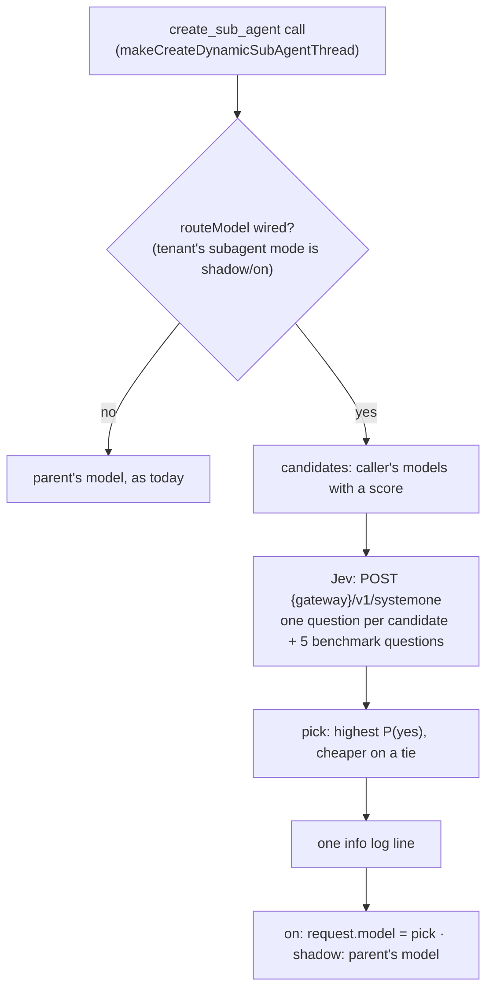

# Subagent model routing with Jev: low-level design

Status: ready for review. Scope: a PoC on internal TrueFoundry tenants, in TrueFoundry mode only.

When a subagent is spawned, one Jev call picks the model it runs on. The router is generic (it takes a `scope`), so the root agent can use it later (§8). Its modules are split so that model routing can later become a capability that also works outside TrueFoundry mode (§9). Only the subagent scope is built now.

**Related work, tracked separately:**

- **`tfg.thread_id` on every model call** (AGE-2837, PR #1392). Routing analysis joins on it.
- **Subagent model overrides** (AGE-2841). A subagent on a different model must use that model's own default params, not the parent's, and `THREAD_CREATED` must save the model the subagent actually runs on. Shadow mode doesn't need this. "On" mode does.

## Decisions at a glance

**Fixed by this design.** Changing any of these means a new design review.

| #   | Invariant                                                                                                                                                                   | Where  |
| --- | --------------------------------------------------------------------------------------------------------------------------------------------------------------------------- | ------ |
| I1  | **One Jev call per subagent, made before it starts.** Never during the agent loop.                                                                                          | §1     |
| I2  | **Jev sees only the task and the candidate pool.** One yes/no question per candidate (name, effort, score), plus one per benchmark. No parent model, prices or comparisons. | §3     |
| I3  | **The pick is the candidate with the highest yes-probability,** the cheaper one on a tie. There's no threshold and no price ceiling yet.                                    | §4     |
| I4  | **The fallback is the parent's model.** It runs only when routing can't produce a pick.                                                                                     | §4     |
| I5  | **Candidates are the caller's models that have a score.** No other metadata filters candidates. Other fields are read only for the log line.                                | §2     |
| I6  | **Scores are bundled data,** keyed by Artificial Analysis slug. No Artificial Analysis call while a request runs.                                                           | §2     |
| I7  | **Jev sees each candidate's score at the effort it will actually run at:** its default effort on TrueFoundry.                                                               | §2     |
| I8  | **The router never throws.** Any error, timeout or unusable pick means the parent's model runs, as today.                                                                   | §4     |
| I9  | **The routed model is applied through the existing `request.model` path** and saved on `agent_info.model`. Resume and rebuild never call the router.                        | §1     |
| I10 | **One optional core hook,** `routeModel`. The router's logic lives in the server, split into provider-neutral and TrueFoundry-specific modules.                             | §1, §9 |
| I11 | **Observability:** gateway traces joined on `tfg.thread_id`, plus one info log line per decision. No new tables or public API.                                              | §6     |
| I12 | **Mode per tenant and per scope:** off, shadow or on. Off by default.                                                                                                       | §5     |

**Tunable without a design change:**

- **Config:** the decision model, the Jev timeout (2 s), `max_candidates` (60), and each tenant's mode.
- **Data:** the score table, and the benchmark-resemblance list.

## What it does

1. **The parent calls `create_sub_agent`** with a name and a task.
2. **The router builds the candidates:** the caller's models that have a score (§2).
3. **One Jev call** asks, for each candidate, "can this model complete this task fully and correctly?" (§3). It also asks whether the task resembles each of five public benchmarks. Those answers are only recorded, to learn later which benchmark our work looks like.
4. **The router picks** the candidate with the highest yes-probability (§4). In shadow mode it logs the pick and runs the parent's model. In "on" mode the subagent runs on the pick.
5. **If anything fails,** the subagent runs on the parent's model.



## 1. The router contract

```ts
// trueforge-core: agent-session/ITurnResourceResolver.ts
type RoutingScope = 'subagent' | 'root';

interface RouteModelInput {
  scope: RoutingScope;
  threadId: string; // the thread being routed
  fallbackModel: string; // the parent's model (account/model)
  work: {
    name?: string; // subagent name
    text: string; // the delegated task (self-contained by the create_sub_agent contract)
    tools: string[]; // MCP server names, web_search, sandbox
  };
  signal: AbortSignal;
}

interface RouteModelResult {
  model?: string; // set only in "on" mode when a candidate was picked
}

interface ITurnResourceResolver {
  // ...existing methods
  routeModel?(input: RouteModelInput): Promise<RouteModelResult>; // never throws; undefined = today
}
```

**The call site:** `SessionHandle.makeCreateDynamicSubAgentThread`. If `request.model` is unset, it builds the input and calls `routeModel`. If a model comes back, it continues with `{ ...request, model }`. From there, the existing override path does the rest: `resolveAgentDefinition` resolves `agent_info.model`, and `THREAD_CREATED` saves it (after AGE-2841). A rebuilt or resumed subagent uses its saved model and never calls the router.

## 2. Candidates and scores

**The score is the Artificial Analysis Intelligence Index, v5** (0–100). It's the closest single score to agentic work: seven of its nine evaluations use tools. It averages four equal categories: Knowledge Work, Coding, Science and General.

**The score table** is a typed TypeScript constant in the server package, `modelRouting/modelRoutingScores.ts`. It mirrors Artificial Analysis: one entry per Artificial Analysis slug, so each effort variant is its own entry:

```ts
'claude-haiku-5-5':        { name: 'Claude Haiku 5.5', score: 36.5 },   // plain slug: Artificial Analysis labels it (Max)
'claude-haiku-5-5-medium': { name: 'Claude Haiku 5.5', score: 24.6 },
'mimo-v2-6-pro':           { name: 'MiMo-V2.6-Pro',    score: 29.9 },
```

- **How it's produced:** generated once for the PoC from the Artificial Analysis free endpoint (`/api/v2/language/models/free`), and reviewed like code. A refresh script can come later.
- **Why a TypeScript constant:** it's bundled like the shipped catalogues, and a malformed entry fails at compile time. No loader is needed.
- **The name** is Artificial Analysis's model name without the effort label. It's what Jev sees in the question.

**Candidates are built once per turn from the caller's model list.** An internal `listRoutingCandidates()` on `TrueFoundryModelProviderStore` shares `listModels`' `provider-integrations` fetch. It reads these fields from each model's metadata:

| Field                                                                | Used for                                                                                      |
| -------------------------------------------------------------------- | --------------------------------------------------------------------------------------------- |
| `external_ids.artificial_analysis_slug`                              | Score lookup. A model without a slug, or with one that isn't in the table, isn't a candidate. |
| `params[reasoning_effort].defaultValue`                              | Which effort's score Jev sees.                                                                |
| Price (`public_cost` or `costs`), blended 0.8 × input + 0.2 × output | Breaking ties, and the log line. It's also needed if a threshold or price ceiling is added.   |
| `modalities.input`, `features`                                       | The log line only. No filtering.                                                              |

- **The internal type is widened:** `TrueFoundryEnabledModel` gains these fields. `listModels` and the public `AvailableModel` are unchanged.
- **How a score is looked up:** the exact variant `<slug>-<default effort>` (`-non-reasoning` for `none`). If there isn't one, use the plain slug, then the nearest effort variant, with ties going to the higher one. Variants match exactly, never by prefix. A prefix match would let `claude-sonnet-5` read `claude-sonnet-5-5-*`.
- **A model served by several accounts is asked about once** (same slug), preferring the parent model's account, then its provider, then the first by name.
- **The parent's model is a candidate like any other** if it has a score. If it doesn't, routing still runs among the scored candidates.
- **Revoked access:** candidates come from the caller's model list for this turn, so a pick is a model the caller could use when the turn started. Access revoked mid-turn behaves as it does today for any model: the gateway rejects the call.

**The internal pool today:** 44 chat models, 18 of them scored.

| Model             | Score | TrueFoundry default effort | Score taken from | $/M blended |
| ----------------- | ----- | -------------------------- | ---------------- | ----------- |
| GPT-6 Astra       | 51.6  | medium                     | medium           | 18.00       |
| Claude Opus 5.5   | 48.2  | medium                     | medium           | 7.20        |
| GPT-6.1 Sol       | 46.3  | medium                     | medium           | 3.60        |
| Claude Opus 5     | 44.2  | high                       | unlabelled       | 9.00        |
| Claude Sonnet 5.5 | 41.5  | high                       | high             | 3.60        |
| Grok 4.7          | 35.2  | high                       | high             | 2.80        |
| Qwen 3.8 Max      | 33.7  | xhigh                      | unlabelled       | 2.80        |
| GPT-5.6 Terra     | 32.3  | medium                     | unlabelled       | 4.00        |
| GLM 5.3           | 31.7  | max                        | unlabelled       | 4.00        |
| MiMo V2.6 Pro     | 29.9  | medium                     | unlabelled       | 0.52        |
| GLM 5.3 Flash     | 27.8  | max                        | unlabelled       | 0.22        |
| MiMo V2.6 Flash   | 26.7  | medium                     | unlabelled       | 0.17        |
| Claude Haiku 5.5  | 24.6  | medium                     | medium           | 0.18        |
| GPT-5.6 Luna      | 23.8  | medium                     | unlabelled       | 0.40        |
| MiniMax M3        | 18.9  | medium                     | unlabelled       | 0.96        |
| GPT-6 Luna        | 18.5  | medium                     | medium           | 0.18        |
| Kimi K3           | 17.4  | max                        | low (nearest)    | 5.40        |
| gpt-oss-120b      | 3.8   | medium                     | unlabelled       | 0.43        |

"Unlabelled" means Artificial Analysis publishes a single score with no effort label. That score is usually the model's maximum effort: Haiku 5.5's is 36.5, above its xhigh 34.6. So models that only have an unlabelled score may be overrated at a lower default. "Nearest" means only other efforts are published. Kimi K3, for example, has only a `low` score, so it's likely underrated at its `max` default.

## 3. The Jev request

One call per subagent to `POST {gateway}/v1/systemone`, using the gateway URL, token and turn headers from the parent model's provider config. There's no call when there are no candidates.

```json
{
  "model": "typesafe/jev-1.13.0",
  "state": {
    "scope": "subagent",
    "name": "<subagent name>",
    "task": "<the delegated task, clipped to 8k (head + tail)>",
    "tools": ["<mcp server names>", "web_search", "sandbox"],
    "benchmark_note": "Artificial Analysis Intelligence Index (0-100, higher is better) averages agentic knowledge work, coding, science and general reasoning evaluations."
  },
  "questions": {
    "can_0": {
      "type": "noul",
      "instructions": "Can Claude Haiku 5.5 at medium effort (Intelligence Index 24.6) complete this task fully and correctly?",
      "criteria": {
        "true": "It would produce a result that can be used as-is: complete, accurate, and with the needed tool use done.",
        "false": "It would likely miss parts, make errors, or stop before the task is done."
      }
    },
    "can_1": {
      "type": "noul",
      "instructions": "Can Claude Sonnet 5.5 at high effort (Intelligence Index 41.5) complete this task fully and correctly?",
      "criteria": { "...": "same as above" }
    },
    "resembles_gdpval": {
      "type": "noul",
      "instructions": "Does this task resemble the benchmark GDPval? Knowledge-work deliverables (reports, analyses, plans) produced with tools. Example: 'From these project documents, write a one-page status report with risks and next steps.'",
      "criteria": { "true": "Same kind of work as the benchmark.", "false": "A different kind of work." }
    }
  }
}
```

- **The decision model comes from config,** set per environment: `typesafe/jev-1.13.0` on internal. If a tenant can't reach it, the call fails and the parent's model runs (`decision_error`).
- **Candidate questions** are keyed `can_<n>`, and the router maps them back to models.
- **Limits:** one call, with a 2-second timeout and at most `max_candidates` (60) candidate questions.
- **Benchmark-resemblance questions:** five benchmarks, all of which our key models have data for in `model-benchmarks`. The answers are recorded only.

| Key              | Benchmark            | Description given to Jev                                                                                | Example task given to Jev                                                                          |
| ---------------- | -------------------- | ------------------------------------------------------------------------------------------------------- | -------------------------------------------------------------------------------------------------- |
| `automation`     | AutomationBench-AA   | Multi-step workflows across apps through API tools: look things up, combine results, act on them        | "When a support ticket is tagged urgent, look up the customer's plan and notify the account owner" |
| `terminal_bench` | Terminal-Bench 4.0   | Multi-step technical tasks in a shell: run commands, inspect files and logs, fix or configure something | "Find why the service fails to start from its logs and fix the config"                             |
| `gdpval`         | GDPval-AA            | Knowledge-work deliverables (reports, analyses, plans) produced with tools                              | "From these project documents, write a one-page status report with risks and next steps"           |
| `lcr`            | AA-LCR               | Answer questions that need reasoning across long documents or large outputs                             | "From these three long reports, which risk do all of them mention and how does each address it?"   |
| `hle`            | Humanity's Last Exam | Hard expert-level knowledge and reasoning questions with one correct answer                             | "A difficult graduate-level question in a technical field"                                         |

**Offline test** on 49 real subagent tasks × 11 candidates, checked against how each model actually did:

- **Jev doesn't say yes to everything.** Average yes-probability per model was 0.17–0.42.
- **It ranks models sensibly on average** (rank correlation 0.53 with how often each model passed). On a single task, though, it only weakly tells whether a model will do well: 0.6, where 0.5 is a coin flip.
- **Showing Jev the parent model made it worse.** Jev then mostly compared the two scores. That's why the request has no parent model.
- **The number of questions doesn't matter.** Answers moved by about 0.01 between 3, 11 and 16 candidates. Calls took 0.4–1.2 s for up to 60 questions.

## 4. Picking the model

1. **Pick** the candidate with the highest yes-probability. On a tie, the cheaper one wins.
2. **Fall back to the parent's model** when there's no usable pick. The reason is logged:
   - `no_candidates`;
   - `decision_error`: the call failed, or Jev answered none of the candidate questions;
   - `decision_timeout`.
3. **Shadow mode** logs the pick but runs the parent's model. **On mode** runs the pick.

**In the offline test** (candidates cheaper than Opus 5.5, judged against Opus): Sonnet 5.5 was picked for 47 of 49 tasks. It was as good as Opus on 76% of tasks, at 53% of Opus's cost.

**Expected risk on internal:** with no price ceiling, the pool includes GPT-6 Astra, the highest score at $18/M, which is 2.5× Opus. Jev's answers rise with the score, so many subagents may be picked onto Astra. Shadow mode measures the pick distribution and how often the pick costs more than the parent's model. If picks go up in price too often, the next step is a threshold rule: the cheapest candidate at or above a yes-probability. Prices are already on each candidate, so that's a change to the pick function and config only.

## 5. Modes and config

```json
TRUEFOUNDRY_MODEL_ROUTING = {
  "decision_model": "typesafe/jev-1.13.0",
  "timeout_ms": 2000,
  "max_candidates": 60,
  "tenants": {
    "<tenant_id>": { "subagent": "shadow" }
  }
}
```

- **off** (the default, or when unset): the hook isn't wired, and nothing changes.
- **shadow:** ask Jev and log the decision, but run the parent's model.
- **on:** run the pick.

## 6. Observability

- **Gateway traces,** joined on `tfg.thread_id`:
  - every model call a subagent makes (AGE-2837);
  - the Jev call, which carries the turn metadata plus `tfg.thread_id` (the subagent being routed) and `tfg.model_routing: "true"`.

  The Jev request and response hold every candidate's question and probability, and the benchmark-resemblance answers.

- **One log line per decision:**

  ```ts
  logger.info('model routing', {
    scope,
    thread_id,
    mode,
    reason,
    fallback_model,
    picked_model,
    chosen_model,
    picked_p_yes,
    picked_price,
    fallback_price,
    price_direction,
    picked_image_input,
    candidate_count,
  });
  ```

  - `price_direction` is `up`, `down` or `same`: the pick's price against the parent's model.
  - `picked_image_input` shows whether the pick can read images. That's useful if routed subagents turn out to receive images.
  - The line covers what the traces can't: decisions where Jev wasn't called, why routing fell back, and shadow-mode picks that weren't applied.
  - It never includes task text.

## 7. Rollout

1. **Merge** with the config unset, so nothing changes.
2. **Shadow mode** on a few internal tenants. Check latency, the pick distribution, how often the pick costs more or less than the parent's model, and the fallback reasons.
3. **Switch on** for those tenants once AGE-2841 has merged. Measure quality with user feedback (§10).

## 8. Root agent (later)

The same router, score table, Jev request and pick rule. The root needs four things on top:

- **A call site** where the root thread's definition is built for a turn, with `scope: 'root'` and the spec's model as the fallback.
- **Once per turn,** never mid-turn.
- **Persistence:** save the routed model with the turn, so a resumed turn keeps it.
- **Opt-in:** a per-tenant or per-agent opt-in. A model the user picked explicitly is never overridden.

## 9. Code changes

**Core (`packages/trueforge-core`):** only the hook and the call site. Core has no access to the model list, Jev or the scores.

| File                                     | Change                                                                                                                                              |
| ---------------------------------------- | --------------------------------------------------------------------------------------------------------------------------------------------------- |
| `agent-session/ITurnResourceResolver.ts` | `RoutingScope`, `RouteModelInput`, `RouteModelResult` and the optional `routeModel` hook (§1).                                                      |
| `agent-session/TurnResourceResolver.ts`  | Accept `routeModel` in its deps and expose it.                                                                                                      |
| `agent-session/SessionHandle.ts`         | In `makeCreateDynamicSubAgentThread`, call `routeModel` when `request.model` is unset, and continue with `{ ...request, model }` if one comes back. |

**Server: provider-neutral routing (`packages/trueforge/src/modelRouting/`).** None of this knows about TrueFoundry. It's the part a future routing capability would reuse or move into core.

| File                                          | Change                                                                                                                                                                                                                                   |
| --------------------------------------------- | ---------------------------------------------------------------------------------------------------------------------------------------------------------------------------------------------------------------------------------------- |
| **New** `types.ts`                            | What a provider supplies: `RoutingCandidate` (`model`, `slug`, `defaultEffort`, `price`, `imageInput`), a function that lists them, and `DecisionClient`, which asks yes/no questions and returns probabilities. Also the routing modes. |
| **New** `scores.ts` + `modelRoutingScores.ts` | The score table, and the lookup by slug and effort (§2).                                                                                                                                                                                 |
| **New** `pick.ts`                             | The pick rule, as a pure function from candidates and probabilities to a pick (§4). A threshold or price ceiling would change only this file and the config.                                                                             |
| **New** `router.ts`                           | `createModelRouter({ candidates, decision, scores, config, logger })`. It builds the questions (§3), calls the decision client, picks, logs (§6), and returns `routeModel`. It never throws.                                             |

**Server: TrueFoundry implementations.**

| File                                           | Change                                                                                                                                                                   |
| ---------------------------------------------- | ------------------------------------------------------------------------------------------------------------------------------------------------------------------------ |
| `db/modelProviderStore.ts`                     | An optional `listRoutingCandidates()` on `IModelProviderStore`. Stores that can't supply catalogue metadata omit it, and routing isn't wired for them.                   |
| `truefoundry/mapEnabledModels.ts`              | Widen the internal `TrueFoundryEnabledModel` with the fields in §2. Each new field falls back to undefined on an unexpected shape, so it can never break model listing.  |
| `truefoundry/TrueFoundryModelProviderStore.ts` | `listRoutingCandidates()` for TrueFoundry mode, from the same `provider-integrations` fetch.                                                                             |
| `truefoundry/InlineModelProviderStore.ts`      | Forwards `listRoutingCandidates()` to the wrapped store.                                                                                                                 |
| **New** `truefoundry/jevDecisionClient.ts`     | The `DecisionClient` for Jev: `POST {gateway}/v1/systemone` with the parent model's gateway URL, token and turn headers.                                                 |
| `config.ts`                                    | `TRUEFOUNDRY_MODEL_ROUTING` (§5).                                                                                                                                        |
| `apis/turns.ts`                                | When the tenant's subagent mode isn't off, create the router per turn from the TrueFoundry candidate source and the Jev client, and pass `routeModel` into the resolver. |

No database schema or public API changes.

**Extending outside TrueFoundry mode later:** implement `listRoutingCandidates()` on the configured-provider stores (slug from the shipped catalogue), and add a `DecisionClient` for whatever decision model is available. Then wire them where the resolver is built. The score table, pick rule, router and core hook stay the same.

## 10. Open questions

1. **How is quality measured?** The TrueForge backend doesn't store user feedback. Only the UI runtime passes a feedback adapter through. Feedback is also given per turn, on the root agent's answer, not per subagent. Before "on" mode we need to know where feedback lands on internal tenants, and how to attribute it to subagents.
2. **Model names in the questions:** keep them, or say only "a model with Intelligence Index S" to avoid Jev's preconceptions about names?
3. **Benchmark list:** are these five right?
4. **Threshold or price ceiling:** likely needed soon, if shadow data shows picks go up in price too often (§4). It's a change to `pick.ts` and config only.
