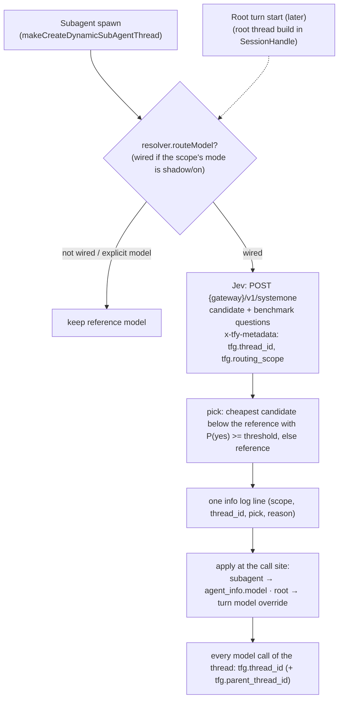

# Model routing with Jev: low-level design (draft for review)

Status: ready for review. Replaces the selection rule in `lld.md` (tier question plus same-creator price rule). The routing is built as one generic router with two call sites:
- **Subagent spawn,** implemented now.
- **The root agent's turn,** a planned extension that uses the same router, tables, Jev call and tracing.

From `lld.md`, the model-params fix and the `THREAD_CREATED` fix still apply.

## Decisions at a glance

**Fixed by this design.** Changing any of these means a new design review.

| # | Invariant | Where |
|---|---|---|
| I1 | **One Jev call per routing decision, made before the thread starts.** Never during the agent loop. A subagent is routed once, and the root once per turn. | §1, §8 |
| I2 | **The Jev payload shape:** `state` = `{ scope, name, task, context, tools, reference_model { name, score } }`; `questions` = one yes/no `can_<n>` per candidate (model name, effort and score in the text) plus one yes/no `resembles_<key>` per benchmark. | §3 |
| I3 | **The pick rule shape:** candidates in price order, cheapest first; take the first whose yes-probability is at or above the threshold; otherwise keep the reference model. | §4 |
| I4 | **Never pick a model that costs more than the reference.** A cheaper model with a higher score is allowed. | §4 |
| I5 | **Candidates come only from the caller's own model list** (the same `provider-integrations` fetch as `listModels`, no extra account filter), and only models in the score table. | §2 |
| I6 | **Scores are bundled data,** generated offline from the Artificial Analysis API. There's no call to Artificial Analysis while a request runs. | §2 |
| I7 | **Scores are read at the effort the thread will actually run at.** A routed thread runs at its own model's default params, never the reference's. | §2, §4 |
| I8 | **If a model is already set on the thread, routing is skipped.** | §4 |
| I9 | **The router never throws.** Any error, timeout or unusable pick means the reference model runs, as today. | §4 |
| I10 | **Only the chosen model is persisted** (`agent_info.model` for subagents). Resume and rebuild never call the router. | §1 |
| I11 | **One generic core hook,** `routeModel(RouteModelInput) → RouteModelResult`, with a `scope`. All routing logic lives in the server. | §1, §9 |
| I12 | **Observability comes from gateway traces,** with `tfg.thread_id` on every model call and on the Jev call, plus one info log line. No new tables or public API for the subagent scope. | §6, §7 |
| I13 | **Mode per tenant and per scope:** off, shadow or on. Off is the default. | §5 |

**Tunable without a design change,** as config or data:
- **Config:** the threshold (0.7), the Jev timeout (2 s), `max_candidates` (60), the decision model ID, and the mode for each tenant and scope.
- **Data:** the score table's contents and which benchmark it's based on (today the Intelligence Index v5), and the benchmark-resemblance list (today five benchmarks).

**Needs a reviewer's decision:** see §11.

## What it does

Before a thread runs, the router asks Jev, the decision model, two things about the work. The thread is a subagent now, and later the root agent.

1. **Routing:** for each candidate model, "can this model complete the task?". Candidates are models the caller can use that are in the model table (§2) and cheaper than the **reference model**: the model the thread would use without routing.
   - **For a subagent,** that's the parent's model.
   - **For the root,** it's the agent spec's model.

   Each question carries the candidate's score. The thread runs on the cheapest candidate Jev says yes to, or otherwise on the reference model. It never picks a model that costs more than the reference. A cheaper model with a higher score is allowed.
2. **Benchmark resemblance:** for each benchmark on a hard-coded list, "does this task resemble the benchmark?". This is recorded only. Over real traffic, it tells us which benchmark our work actually resembles, which is the one to use for evaluation later.

Every model call carries `tfg.thread_id` in `x-tfy-metadata`, and so does the Jev call. The gateway traces then show which thread each call belongs to and how it was routed.



## 1. The router contract (generic)

The router knows nothing about subagents or roots. Each call site builds one `RouteModelInput`, and applies the `RouteModelResult` its own way.

```ts
// trueforge-core: agent-session/ITurnResourceResolver.ts
type RoutingScope = 'subagent' | 'root';

interface RouteModelInput {
  scope: RoutingScope;
  threadId: string;                 // the thread being routed (child thread id, or root thread id)
  parentThreadId?: string;          // subagent only
  referenceModel: string;           // model the thread would use without routing (account/model)
  work: {                           // what Jev classifies
    name?: string;                  // subagent name; root: agent name
    text: string;                   // subagent: delegated task; root: latest user message
    context?: string;               // subagent: the user's request; root: short recent-conversation excerpt
    tools: string[];                // MCP server names, web_search, sandbox
  };
  spec: AgentSpec;
  signal: AbortSignal;
  tracing: AgentTracing;
}

interface RouteModelResult {
  model?: string;                   // set only in "on" mode when a cheaper model was picked
}

interface ITurnResourceResolver {
  // ...existing methods
  routeModel?(input: RouteModelInput): Promise<RouteModelResult>;   // never throws; undefined hook = today
}
```

**Call sites:**

| Scope | Where | Builds `work` from | Applies the result | When |
|---|---|---|---|---|
| `subagent` | `SessionHandle.makeCreateDynamicSubAgentThread` | `create_sub_agent` name and input, the turn's user message, the subagent's tools | `request.model = result.model`, so `resolveAgentDefinition` picks it up. It's persisted on `agent_info.model` through `THREAD_CREATED`. | Now |
| `root` | Where `SessionHandle` builds the root thread's definition for a turn (`resolveAgentDefinition` without `agent_info`) | The turn's user message, a clipped excerpt of recent conversation, the agent's tools | Pass as a model override into the root `resolveAgentDefinition`, and persist it with the turn so approval or user-input resumes keep the same model (§8) | Later |

Resume and rebuild never call the router. A subagent is rebuilt from its saved `agent_info`. A resumed root turn reuses the model stored for that turn.

## 2. Hard-coded tables

**The score is the Artificial Analysis Intelligence Index, v5,** on a 0–100 scale. It's the closest single score to agentic work: seven of its nine evaluations use tools, all run in Artificial Analysis's open-source agent harness, Stirrup. It has four equal categories:
- **Knowledge Work:** AA-Briefcase, AutomationBench-AA, GDP.pdf.
- **Coding:** FrontierCode-AA, Terminal-Bench 4.0.
- **Science:** Terminal-Bench-Science, CritPt.
- **General:** AA-Omniscience, HLE.

The General quarter isn't tool use, and that's accepted for now.

**The model table** is keyed by `canonical_model`, so one row covers every account serving the model.
- **Source:** the Artificial Analysis API (`/api/v2/language/models/free`), matched by the `external_ids.artificial_analysis_slug` that TrueFoundry already stores on each model.
- **Storage:** a JSON file checked into the server package, `truefoundry/modelRoutingScores.json`. It's written by an offline refresh script and reviewed like any code change. The server loads it once at startup into an in-memory `Map<canonical_model, ModelScores>`, and validates it with zod, so a bad file fails at startup, not mid-request. Refreshing means re-running the script, committing and deploying.
- **Shape:** nested by effort level, keeping every score Artificial Analysis reports for the model. Non-reasoning variants go under `none`, and a variant with no effort label under `default`:

```json
{
  "source": "Artificial Analysis Intelligence Index", "index_version": "5", "retrieved_at": "2026-11-13",
  "models": {
    "anthropic/claude-haiku-5-5": { "aa_slug": "claude-haiku-5-5",
      "efforts": { "low": 18.6, "medium": 24.6, "high": 29.9, "xhigh": 34.6, "max": 36.5 } },
    "anthropic/claude-opus-5-5": { "aa_slug": "claude-opus-5-5",
      "efforts": { "low": 34.8, "medium": 48.2, "high": 51.8, "xhigh": 57.4, "max": 59.1 } },
    "google/gemini-3-5-flash-lite": { "aa_slug": "gemini-3-5-flash-lite", "efforts": { "default": 11.7 } }
  }
}
```

- **Lookup at request time** uses the effort the thread will actually run at:
  - **For a candidate,** that's its default effort from TrueFoundry's metadata.
  - **For the reference,** it's `spec.model.params.reasoning_effort` if set, otherwise its default. So an Opus root running at high is compared at 51.8, not 48.2.
  - **The fallback order** is the exact effort, then `default`, then the nearest effort with a score, with ties going to the higher one.

Scores looked up at each model's default effort, with the variant used and the TrueFoundry default:

| `canonical_model` | Intelligence Index | Variant used (TrueFoundry default) |
|---|---|---|
| `openai/gpt-6-astra` | 51.6 | medium (medium) |
| `google/gemini-4-argon` | 50.4 | high (medium) |
| `anthropic/claude-opus-5-5` | 48.2 | medium (medium) |
| `anthropic/claude-fable-5-1` | 47.2 | high (high) |
| `openai/gpt-6-1-sol` | 46.3 | medium (medium) |
| `openai/gpt-6-sol` | 44.2 | max (medium) |
| `anthropic/claude-opus-5` | 44.2 | max (high) |
| `anthropic/claude-sonnet-5-5` | 41.5 | high (high) |
| `xai/grok-4-7` | 35.5 | xhigh (not set) |
| `openai/gpt-5-6-terra` | 32.3 | max (medium) |
| `xai/grok-4-6` | 31.0 | xhigh (low) |
| `google/gemini-3-8-flash` | 30.1 | medium (medium) |
| `anthropic/claude-haiku-5-5` | 24.6 | medium (medium) |
| `openai/gpt-5-6-luna` | 23.8 | max (medium) |
| `openai/gpt-6-luna` | 18.5 | medium (medium) |
| `kimi/kimi-k3` | 17.4 | low (max) |
| `google/gemini-3-5-flash-lite` | 11.7 | unlabelled (minimal) |

That's 35 of devtest's 465 distinct models, and 17 of the 49 pool models. Models used on devtest that have no v5 score in any variant include Sonnet 4.6 (the most common devtest root), the Opus 4.x models, GLM 5.2 and Gemini 3.6 and 3.7 Flash. A model not in the table is never a candidate, and a reference model not in the table isn't routed (§5).

**Candidates are built per call from the caller's model list,** through an internal `listRoutingCandidates()` on `TrueFoundryModelProviderStore`.
- **It shares `listModels`' fetch and mapping:** the same `provider-integrations` call, with the caller's token and the tenant's account allow-list.
- **Only the internal `TrueFoundryEnabledModel` type is widened,** with `canonical_model`, price, features, status, retirement date and default effort.
- **`listModels` and the public `AvailableModel` schema are unchanged.**
- **It's called once per turn and cached.**

A model is a candidate when it's:
- an active chat model with tool calling, not retiring within 30 days,
- reasoning-capable, if the reference reasons,
- in the model table,
- and cheaper than the reference, using the blended price of 0.8 × input plus 0.2 × output.

If several accounts serve the same model, it's asked about once, preferring the reference's account, then its provider, then the first by name. There's no fixed limit. On devtest, Jev took 0.9, 0.9, 1.2 and 1.2 seconds for 6, 20, 40 and 60 candidate questions plus 7 benchmark questions.

**Benchmarks for the resemblance questions.** These are only benchmarks that `model-benchmarks` has data for, and that cover all the models we route between today (Opus 5.5, Sonnet 5.5, Haiku 5.5, GPT-6.1 Sol, GPT-6 Sol, GPT-6 Luna, Gemini 4, Gemini 3.8 Flash and Grok 4.7). So whichever one our tasks resemble, we can switch the score table to it straight away. The descriptions and examples are our own paraphrases.

| Key | Benchmark (`model-benchmarks` metric) | Pool coverage | Description given to Jev | Example task given to Jev |
|---|---|---|---|---|
| `automation` | AutomationBench-AA (`automationbench_partial_score`) | 34/49 | Multi-step workflows across apps through API tools: look things up, combine results, act on them | "When a support ticket is tagged urgent, look up the customer's plan and notify the account owner" |
| `terminal_bench` | Terminal-Bench 4.0 (`terminalbench_v4_0`) | 33/49 | Multi-step technical tasks in a shell: run commands, inspect files and logs, fix or configure something | "Find why the service fails to start from its logs and fix the config" |
| `gdpval` | GDPval-AA (`gdpval_aa_elo`) | 37/49 | Knowledge-work deliverables (reports, analyses, plans) produced with tools | "From these project documents, write a one-page status report with risks and next steps" |
| `lcr` | AA-LCR (`lcr`) | 48/49 | Answer questions that need reasoning across long documents or large outputs | "From these three long reports, which risk do all of them mention and how does each address it?" |
| `hle` | Humanity's Last Exam (`hle`) | 49/49 | Hard expert-level knowledge and reasoning questions with one correct answer | "A difficult graduate-level question in a technical field" |

These were left out because the repo covers them too thinly, or not for our key models: EnterpriseOps-Gym, tau2 and IFBench (none of the key models), ITBench, FrontierCode and AnalystAgent (sparse in the pool).

## 3. The Jev request

One call per routing decision to `POST {gateway}/v1/systemone`, with the gateway URL and token borrowed from the reference model's provider config, as in `lld.md`. A reference model not in the table skips the call.

```json
{
  "model": "archit-typesafe/jev-1.13.0",
  "state": {
    "scope": "subagent",
    "name": "<subagent name | agent name>",
    "task": "<work.text, clipped to 8k (head + tail)>",
    "context": "<work.context, clipped to 4k>",
    "tools": ["<mcp server names>", "web_search", "sandbox"],
    "reference_model": { "name": "Claude Opus 5.5", "intelligence_index": 48.2 },
    "benchmark_note": "Artificial Analysis Intelligence Index (0-100, higher is better) averages agentic knowledge work, coding, science and general reasoning evaluations."
  },
  "questions": {
    "can_0": {
      "type": "noul",
      "instructions": "Can Claude Haiku 5.5 at medium effort (Intelligence Index 24.6) complete this task fully and correctly, about as well as the reference model (Intelligence Index 48.2)?",
      "criteria": {
        "true": "It would produce a result that can be used as-is: complete, accurate, and with the needed tool use done.",
        "false": "It would likely miss parts, make errors, or stop before the task is done."
      }
    },
    "can_1": { "type": "noul", "instructions": "Can Claude Sonnet 5.5 (Intelligence Index 41.5) complete ...", "criteria": { "...": "same as above" } },
    "resembles_automation": {
      "type": "noul",
      "instructions": "Does this task resemble the benchmark AutomationBench? Multi-step workflows across apps through API tools: look things up, combine results, act on them. Example: 'When a support ticket is tagged urgent, look up the customer's plan and notify the account owner.'",
      "criteria": { "true": "Same kind of work as the benchmark.", "false": "A different kind of work." }
    }
  }
}
```

- **The wording is scope-neutral,** with "task" and "reference model", so the root call site sends the same shape with `scope: "root"`.
- **Candidate questions** are keyed `can_<n>`, and the router maps them back to models.
- **All five benchmark questions** go in every call.
- **One call,** with a 2-second timeout and `max_candidates` (default 60) as a safety cap.

## 4. Picking the model

1. **Order:** candidates sorted by price, cheapest first. On a price tie, the higher score goes first.
2. **Pick** the first candidate with `noul >= threshold`. The default threshold is 0.7.
3. **Fall back to the reference model:**
   - when no candidate reaches the threshold (`no_candidate_confident`),
   - when the reference isn't in the table (`reference_not_in_table`),
   - when Jev fails or times out (`decision_error` / `decision_timeout`),
   - or when the pick can't be resolved for the caller (`model_unavailable`, using the existing `getModel` check).
4. **Never pick a more expensive model.** The limit is price, not quality: a candidate must be cheaper than the reference, but it may score higher. For example, Gemini 4 (50.4) is a candidate for an Opus 5.5 reference (48.2 at medium). Moving to a pricier model, even a better one, isn't done, because the goal is saving cost and the reference's price is what the user signed up for.
5. **If a model is already set, skip routing.**
   - **For a subagent,** that's `agent_info.model`. It can only be set today if the agent spec defines a model set for `create_sub_agent` (`modelSetConfig`), which nothing does yet.
   - **For the root,** it's a model the user picked explicitly (§8).

   A deliberate choice is never overridden.
6. **Routed threads use their own model's default params,** not the reference's (the fix from `lld.md` §5).

**Example:** a subagent whose reference is Opus 5.5 (48.2). In price order, Jev answers Haiku 5.5 0.42, GPT-6 Luna 0.35, Gemini 3.8 Flash 0.30, …, Grok 4.7 0.81, …, Sonnet 5.5 0.88. The first answer at or above 0.7 is Grok 4.7 ($2.80), so the subagent runs on Grok 4.7.

## 5. Modes and config

Modes are set per tenant **and per scope**, so root routing can be turned on separately later.

```json
TRUEFOUNDRY_MODEL_ROUTING = {
  "decision_model": "archit-typesafe/jev-1.13.0",
  "timeout_ms": 2000,
  "threshold": 0.7,
  "max_candidates": 60,
  "tenants": {
    "<tenant_id>": { "subagent": "shadow", "root": "off" }
  }
}
```

- **off** (the default, or when unset): no call. The hook isn't wired for that scope.
- **shadow:** ask Jev and log the decision, but run on the reference model.
- **on:** run on the pick.

## 6. Tracing: `tfg.thread_id`

TrueForge's own `AgentTracing` is a no-op by default (`createTracing()` returns `NOOP_AGENT_TRACING`). The traces we can see are the gateway's request traces, which record each call's `x-tfy-metadata`. The turn-level keys are there (`tfg.session_id`, `tfg.turn_id`, `tfg.agent_id`, `tfg.agent_name`), but nothing identifies the thread.
- **Every thread's model calls:** in `AgentThread`, the model call `modelClient.create(requestBody)` gets `{ metadata: { 'tfg.thread_id': this.threadId, ...(parent ? { 'tfg.parent_thread_id': parent.thread_id } : {}) } }`.
  - `buildOutboundRequestHeaders` already folds this into `x-tfy-metadata`.
  - It covers the root thread and subagents alike, so root routing needs nothing extra here.
  - Context compaction merges the same keys alongside `tfg.compaction`.
- **The Jev call** carries the turn metadata, plus `tfg.thread_id` (the thread being routed), `tfg.routing_scope` and `tfg.model_routing: "true"`.
- **Joining on `tfg.thread_id`** links the Jev request and response with every model call the thread made (§7).

## 7. What's observable, and the one log line

Most of the decision is already in the gateway traces, joined by `tfg.thread_id`:
- **The Jev request:** every candidate, with its score, and the benchmark questions.
- **The Jev response:** the probability for each one, including the benchmark-resemblance answers.
- **Every model call the thread made:** the served model, tokens, cost and latency.

Two things never reach a trace:
- **Decisions where Jev isn't called:** the reference isn't in the table, the model was explicit, or the scope is off.
- **The router's own result:** which candidate it picked, why it fell back, and in shadow mode the pick it didn't apply.

For those, the router writes one plain `logger.info('model routing', { scope, thread_id, mode, reference_model, picked_model, chosen_model, reason })`. It's for our own understanding, not a schema or a contract, and never includes task text.

User feedback is joined by `thread_id`. The benchmark-resemblance counts are read from the Jev responses in the traces.

## 8. Extending to the root agent (later)

The router, tables, Jev request, pick rule, config and tracing are all shared. What the root needs on top:

- **A call site:** where `SessionHandle` builds the root thread's definition for a turn. It builds `RouteModelInput` with `scope: 'root'` and the spec's model as the reference, and passes the result as a model override into the root `resolveAgentDefinition`. That's an optional `modelOverride` input, alongside `agent_info`.
- **Granularity: once per turn,** keeping the model for the whole turn. Re-deciding mid-turn would change model during an agent loop, which the Artemis baseline showed hurts. A session-level sticky option (keep the first turn's choice) can come later, if prompt caching matters more than per-turn savings.
- **Persistence:** store the routed model with the turn, as a turn-snapshot field, so a resumed turn (after an approval or user input) keeps the same model and never re-classifies. It's the only new stored field, and it's needed only for root.
- **Opt-in:** route the root only when the agent or tenant opts in. For example, a spec setting like `model: { name: <reference>, auto: true }`, or the per-scope tenant mode. A model the user picked explicitly is never overridden.
- **State:** the latest user message plus a clipped excerpt of recent conversation, instead of a delegated task.

## 9. Code changes (subagent scope now)

**Core (`packages/trueforge-core`):**

| File | Change |
|---|---|
| `agent-session/ITurnResourceResolver.ts` | `RoutingScope`, `RouteModelInput`, `RouteModelResult`, and the optional hook `routeModel?(input)` (§1). |
| `agent-session/TurnResourceResolver.ts` | Forward the hook from deps, and pass `isModelAvailable` (built on `getModel`). Plus the params fix from `lld.md` §5. |
| `agent-session/SessionHandle.ts` `makeCreateDynamicSubAgentThread` | Build `RouteModelInput` (`scope: 'subagent'`) and call `routeModel`. If `model` comes back, use `{ ...request, model }` from then on. |
| `core/runtime/AgentThreadOrchestrator.ts` (`AGENT_CREATE_SUBAGENT`) | Build `THREAD_CREATED.agent_info` from `subAgentThread.agentInfo`, so the routed model is persisted. |
| `core/runtime/AgentThread.ts` | Pass `tfg.thread_id` and `tfg.parent_thread_id` metadata on every model call (§6). |

**Server (`packages/trueforge`):**

| File | Change |
|---|---|
| `config.ts` | `TRUEFOUNDRY_MODEL_ROUTING`, with per-tenant, per-scope modes (§5). |
| `truefoundry/mapEnabledModels.ts` | Widen the internal `TrueFoundryEnabledModel` with `canonical_model`, price, features, status, retirement date and default effort. `listModels` keeps returning the public `AvailableModel`, unchanged. |
| `truefoundry/TrueFoundryModelProviderStore.ts` | The internal `listRoutingCandidates()`, using the same fetch and mapping as `listModels` (§2). |
| **New** `truefoundry/modelRoutingScores.json` | The score table, nested by effort level, with source, version and date (§2). It's generated by the refresh script. |
| **New** `truefoundry/modelRoutingTables.ts` | Loads and validates the JSON at startup into an in-memory map, does the lookup by effort with its fallback order, and holds the five benchmark descriptions (§2). |
| **New** `benchmark/refresh_model_scores.py` (offline) | Calls the Artificial Analysis API, matches models by slug, and writes `modelRoutingScores.json`. |
| **New** `truefoundry/modelRouter.ts` | `createModelRouter()`, which returns `routeModel`. It's scope-agnostic: candidates (§2), the Jev request (§3), the pick (§4), one info log line (§7). It never throws. |
| `apis/turns.ts` | Wire `routeModel` when any scope for the tenant isn't off. The router checks the per-scope mode itself. |

The subagent scope needs no database schema or public API changes, since `agent_info.model` already exists. The root scope adds one turn-snapshot field (§8).

## 10. Rollout

1. Merge with the config unset, so nothing changes.
2. Run subagent scope in shadow mode for two or three devtest tenants. Check latency, the fallback reasons, the pick distribution and `top_benchmark`.
3. Switch subagent scope to "on" for those tenants. Measure with user feedback, joined by `thread_id`.
4. Add the root call site (§8), and run root scope in shadow mode first.
5. Use the resemblance data to choose the evaluation benchmark, and replace the score table if a narrower one fits better.

## 11. Open questions for review

1. **Unscored models in use:** Sonnet 4.6, the Opus 4.x models and GLM 5.2 have no v5 score. Should they get a hand-assigned tier so they can be candidates or references, or stay unrouted?
2. **Pick rule:** the cheapest candidate with P(yes) ≥ 0.7, or the highest P(yes) among cheaper candidates?
3. **Model names in the questions:** name them, as in option 1 of the picture, or say only "a model with Intelligence Index S" to avoid Jev's priors about names?
4. **Benchmark list:** are these five right? Should there also be a single "closest benchmark" choice question?
5. **Root scope:** routing once per turn or once per session, and how a user or agent opts in to an automatically selected model.
6. **Traces:** is the gateway request trace with `x-tfy-metadata` enough, or should a real TrueForge tracer be wired up as well?
